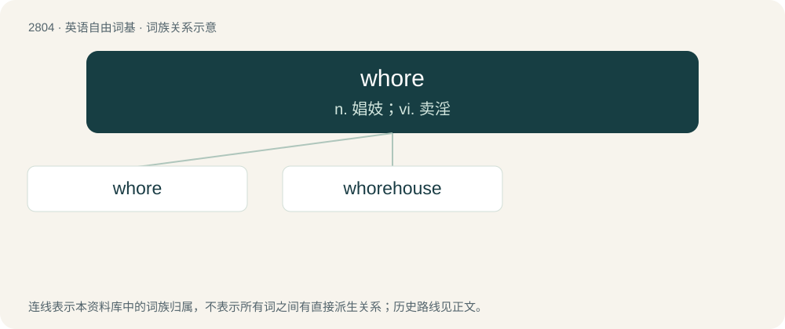

# 2910 · whore — n. 娼妓；vi. 卖淫

[总目录](../00_总目录_按常用程度.md)

**类型**：英语自由词基　｜　**来源语言**：见词源记录

## 核心含义与来源

- 核心含义：n. 娼妓；vi. 卖淫
- 英文含义：Synonym of prostitute: a person (especially a woman) who offers sexual services for payment.
- 词形：whore

**来源记录 1**（名词；Synonym of prostitute: a person (especially a woman) who offers sexual services for payment.）

From Middle English hore, from Old English hōre, from Proto-Germanic \*hōrǭ, from Proto-Indo-European \*kéh₂ros (“loved”), from \*keh₂- (“to wish; desire”). Cognate with Dutch hoer, German Hure, Old Norse hóra as well as Sanskrit चारु (cā́ru, “dear”), Latin cārus (“dear, expensive”), and Irish cara (“friend”). The unetymological spelling with wh- superficially denotes a formerly standard pronunciation with an excrescent /w/ (such as in whole), but such a form is hardly found in either commentators on Early Modern English pronunciations or records of traditional dialects (which both explicitly mention its rarity or absence), therefore leaving the spelling somewhat inexplicable. However, this may be because such an excrescent /w/ was absorbed by a following /uː/ (as in words with etymological /w/ such as whom, two) after it became established in the spelling but before our earliest orthoepic records.

## 词族图

## 单词速览（常用到不常用）

| 单词 | 音标 | 释义 |
|---|---|---|
| [whore](#w-1) | 英 /hɔː/；美 /hɔɚ/ | n. 娼妓；vi. 卖淫 |
| [whorehouse](#w-2) | /ˈhɒːhaus/ | n. 妓院 |

## 逐词详解

### 1. whore

**词性**：动词　｜　**音标**：英 /hɔː/；美 /hɔɚ/

**中文释义**：n. 娼妓；vi. 卖淫

**英文义项**：To prostitute oneself. / To engage the services of a prostitute.

**词源与演化**：

From Middle English hore, from Old English hōre, from Proto-Germanic \*hōrǭ, from Proto-Indo-European \*kéh₂ros (“loved”), from \*keh₂- (“to wish; desire”). Cognate with Dutch hoer, German Hure, Old Norse hóra as well as Sanskrit चारु (cā́ru, “dear”), Latin cārus (“dear, expensive”), and Irish cara (“friend”). The unetymological spelling with wh- superficially denotes a formerly standard pronunciation with an excrescent /w/ (such as in whole), but such a form is hardly found in either commentators on Early Modern English pronunciations or records of traditional dialects (which both explicitly mention its rarity or absence), therefore leaving the spelling somewhat inexplicable. However, this may be because such an excrescent /w/ was absorbed by a following /uː/ (as in words with etymological /w/ such as whom, two) after it became established in the spelling but before our earliest orthoepic records.

**例句**：

> You were with that whore. I can smell it all over you.

### 2. whorehouse

**词性**：名词　｜　**音标**：/ˈhɒːhaus/

**中文释义**：n. 妓院

**英文义项**：Brothel.

**构词拆分**：whore + house

**词源与演化**：

From Middle English horehous, equivalent to whore + house. Cognate with Dutch hoerenhuis (“whorehouse”), German Hurenhaus (“whorehouse”), Danish horehus (“whorehouse”), Swedish horhus (“whorehouse”), Icelandic hóruhús (“whorehouse; brothel”).

**例句**：

> A country with no whorehouse is not a country.
