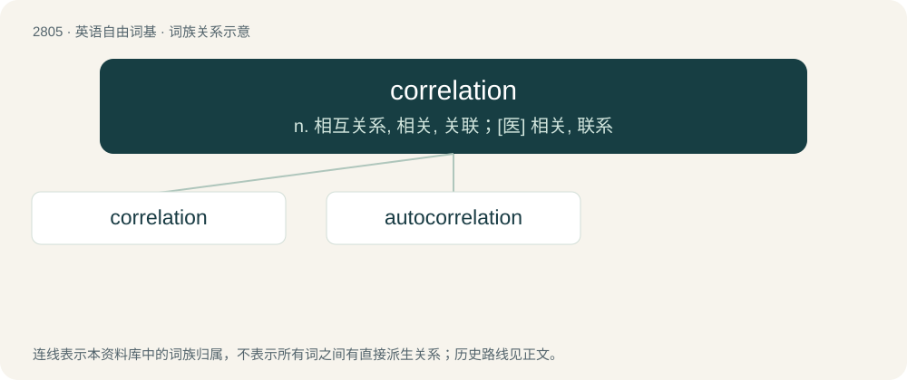

# 2912 · correlation — n. 相互关系, 相关, 关联；\[医\] 相关, 联系

[总目录](../00_总目录_按常用程度.md)

**类型**：英语自由词基　｜　**来源语言**：见词源记录

## 核心含义与来源

- 核心含义：n. 相互关系, 相关, 关联；\[医\] 相关, 联系
- 英文含义：A reciprocal, parallel or complementary relationship between two or more comparable objects.
- 词形：correlation

**来源记录 1**（名词；A reciprocal, parallel or complementary relationship between two or more comparable objects.）

From Middle French corrélation. Morphologically correlate + -ion.

## 词族图

## 单词速览（常用到不常用）

| 单词 | 音标 | 释义 |
|---|---|---|
| [correlation](#w-1) | 英 /ˌkɒɹ.əˈleɪ.ʃən/；美 /ˌkɔɹ.əˈleɪ.ʃən/ | n. 相互关系, 相关, 关联；\[医\] 相关, 联系 |
| [autocorrelation](#w-2) | /,ɔːtəukɔriˈleiʃən/ | n. 自相关；\[计\] 自相关 |

## 逐词详解

### 1. correlation

**词性**：名词　｜　**音标**：英 /ˌkɒɹ.əˈleɪ.ʃən/；美 /ˌkɔɹ.əˈleɪ.ʃən/

**中文释义**：n. 相互关系, 相关, 关联；\[医\] 相关, 联系

**英文义项**：A reciprocal, parallel or complementary relationship between two or more comparable objects. / One of the several measures of the linear statistical relationship between two random variables, indicating both the strength and direction of the relationship.

**构词拆分**：correlate + -ion

**词源与演化**：

From Middle French corrélation. Morphologically correlate + -ion.

**用法示例／搭配（非完整句）**：

> positive correlation

该用例对应义项：A reciprocal, parallel or complementary relationship between two or more comparable objects.

### 2. autocorrelation

**词性**：名词　｜　**音标**：/,ɔːtəukɔriˈleiʃən/

**中文释义**：n. 自相关；\[计\] 自相关

**英文义项**：The cross-correlation of a signal with itself: the correlation between values of a signal in successive time periods.

**构词拆分**：From auto- + correlation.

**词源与演化**：

From auto- + correlation.
