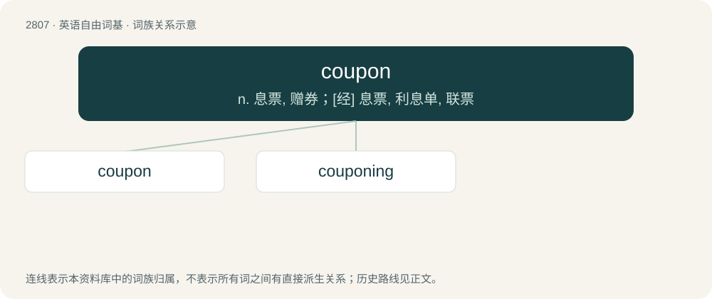

# 2915 · coupon — n. 息票, 赠券；\[经\] 息票, 利息单, 联票

[总目录](../00_总目录_按常用程度.md)

**类型**：英语自由词基　｜　**来源语言**：见词源记录

## 核心含义与来源

- 核心含义：n. 息票, 赠券；\[经\] 息票, 利息单, 联票
- 英文含义：A section of a ticket, showing the holder to be entitled to some specified accommodation or service, as to a passage over a designated line of travel, a particular seat in a theater, a discount, etc.
- 词形：coupon

**来源记录 1**（名词；A section of a ticket, showing the holder to be entitled to some specified accommodation or service, as to a passage over a designated line of travel, a particular seat in a theater, a discount, etc.）

From French coupon, from couper (“to cut”).

## 词族图

## 单词速览（常用到不常用）

| 单词 | 音标 | 释义 |
|---|---|---|
| [coupon](#w-1) | 美 /ˈkuːˌpɑn/；/ˈkʲuːˌpɑn/ | n. 息票, 赠券；\[经\] 息票, 利息单, 联票 |
| [couponing](#w-2) |  | 票券兑换；票证分配 |

## 逐词详解

### 1. coupon

**词性**：动词　｜　**音标**：美 /ˈkuːˌpɑn/；/ˈkʲuːˌpɑn/

**中文释义**：n. 息票, 赠券；\[经\] 息票, 利息单, 联票

**英文义项**：To use coupons to a such extent that makes the user actively looking for coupons in magazines, online and whatever they can be found.

**词源与演化**：

From French coupon, from couper (“to cut”).

**例句**：

> Jenna coupons and she goes through three magazines a day to find the coupons.

该用例对应义项：To use coupons to a such extent that makes the user actively looking for coupons in magazines, online and whatever they can be found.

### 2. couponing

**词性**：名词

**中文释义**：票券兑换；票证分配

**英文义项**：The use or distribution of money-saving coupons.

**构词拆分**：coupon + -ing

**词源与演化**：

From coupon + -ing.
