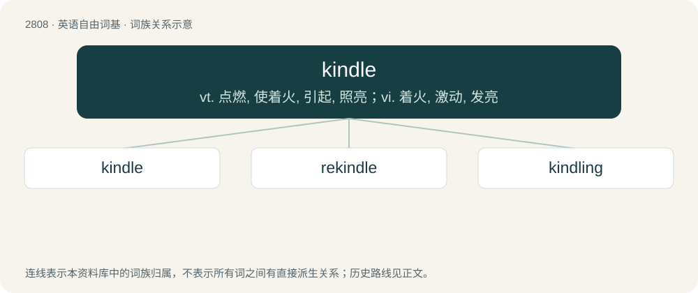

# 2917 · kindle — vt. 点燃, 使着火, 引起, 照亮；vi. 着火, 激动, 发亮

[总目录](../00_总目录_按常用程度.md)

**类型**：英语自由词基　｜　**来源语言**：见词源记录

## 核心含义与来源

- 核心含义：vt. 点燃, 使着火, 引起, 照亮；vi. 着火, 激动, 发亮
- 英文含义：To start (a fire) or light (a torch, a match, coals, etc.).
- 词形：kindle

**多个词源／构词路径**：同一拼写可能有不同来源；以下按词性和含义分别列出。

**来源记录 1**（动词；To start (a fire) or light (a torch, a match, coals, etc.).）

From Middle English kyndelen, from Old Norse kynda (“to inflame”), from Proto-Germanic \*kundijaną.

**来源记录 2**（名词；A group, usually a litter, of kittens, or sometimes cats more generally.）

From Middle English kyndel, from kynde + -el. The verb is derived from the noun form by conversion.

## 词族图

## 单词速览（常用到不常用）

| 单词 | 音标 | 释义 |
|---|---|---|
| [kindle](#w-1) | /ˈkɪn.dəl/ | vt. 点燃, 使着火, 引起, 照亮；vi. 着火, 激动, 发亮 |
| [rekindle](#w-2) | /.riːˈkindl/ | vt. 再点火, 重新激起；vi. 重新燃烧 |
| [kindling](#w-3) | /ˈkɪnd.lɪŋ/ | n. 点火, 发火, 兴奋 |

## 逐词详解

### 1. kindle

**词性**：动词　｜　**音标**：/ˈkɪn.dəl/

**中文释义**：vt. 点燃, 使着火, 引起, 照亮；vi. 着火, 激动, 发亮

**英文义项**：To start (a fire) or light (a torch, a match, coals, etc.). / To arouse or inspire (a passion, etc).

**词源与演化**：

From Middle English kyndelen, from Old Norse kynda (“to inflame”), from Proto-Germanic \*kundijaną.

**例句**：

> Will you buy a Kindle, a Nook or a Kobo eReader?

### 2. rekindle

**词性**：动词　｜　**音标**：/.riːˈkindl/

**中文释义**：vt. 再点火, 重新激起；vi. 重新燃烧

**英文义项**：To kindle again. / To be kindled or ignited again.

**构词拆分**：re- + kindle

**词源与演化**：

From re- + kindle.

**例句**：

> He returned to Algeria to rekindle his relationship with Skura.

### 3. kindling

**词性**：名词　｜　**音标**：/ˈkɪnd.lɪŋ/

**中文释义**：n. 点火, 发火, 兴奋

**英文义项**：Small pieces of wood and twigs used to start a fire. / The act by which something is kindled.

**构词拆分**：From kindle + -ing.

**词源与演化**：

From kindle + -ing.

**例句**：

> Go and collect some kindling.

该用例对应义项：Small pieces of wood and twigs used to start a fire.
