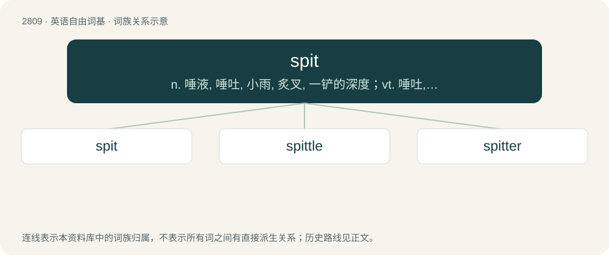

# 2918 · spit — n. 唾液, 唾吐, 小雨, 炙叉, 一铲的深度；vt. 唾吐, 吐出, 降小雨, 用炙叉穿过；vi. 吐唾沫, 吐痰, 唾弃, 飘霏霏细雨

[总目录](../00_总目录_按常用程度.md)

**类型**：英语自由词基　｜　**来源语言**：见词源记录

## 核心含义与来源

- 核心含义：n. 唾液, 唾吐, 小雨, 炙叉, 一铲的深度；vt. 唾吐, 吐出, 降小雨, 用炙叉穿过；vi. 吐唾沫, 吐痰, 唾弃, 飘霏霏细雨
- 英文含义：A thin metal or wooden rod on which meat is skewered for cooking, often over a fire.
- 词形：spit

**多个词源／构词路径**：同一拼写可能有不同来源；以下按词性和含义分别列出。

**来源记录 1**（名词；A thin metal or wooden rod on which meat is skewered for cooking, often over a fire.）

The noun is from Middle English spit, spite, spete, spette, spyte, spytte (“rod on which meat is cooked; rod used as a torture instrument; short spear; point of a spear; spine in the fin of a fish; pointed object; dagger symbol; land projecting into the sea”), from Old English spitu (“rod on which meat is cooked; spit”), from Proto-Germanic \*spitō (“rod; skewer; spike”), \*spituz (“rod on which meat is cooked; stick”), from Proto-Indo-European \*speyd-, \*spey- (“sharp; sharp stick”). The English word is cognate with Dutch spit, Low German Spitt (“pike, spear; spike; skewer; spit”), Danish spid, Swedish spett (“skewer; spit; type of crowbar”). The verb is derived from the noun, or from Middle English spiten (“to put on a spit; to impale”), from spit, spite: see above. The English verb is cognate with Middle Dutch speten, spitten (modern Dutch speten), Middle Low German speten (Low German spitten, modern German spießen (“to skewer, to spear”), spissen (now dialectal)) and Danish spidde.

**来源记录 2**（动词；To evacuate (saliva or another substance) from the mouth, etc.）

The verb is from Middle English spē̆ten, spete (“to spit (blood, phlegm, saliva, venom, etc.); of a fire: to emit sparks”), from Old English spǣtan (“to spit; to squirt”); or from Middle English spit, spitte, spitten (“to spit (blood, phlegm, saliva, venom, etc.); of a fire: to emit sparks”), from Old English spittan, spyttan (“to spit”), both from Proto-Germanic, from Proto-Indo-European \*sp(y)ēw, \*spyū, ultimately imitative; compare Middle English spitelen (“to spit out, expectorate”) and English spew. The English word is cognate with Danish spytte (“to spit”), North Frisian spütte, Norwegian spytte (“to spit”), Swedish spotta (“to spit”), Old Norse spýta (Faroese spýta (“to spit”), Icelandic spýta (“to spit”)). The noun is derived from the verb; compare Danish spyt (“spit”), Middle English spit, spytte (“saliva, spittle, sputum”), spet (“saliva, spittle”), spē̆tel (“saliva, spittle”), North Frisian spiit.

**来源记录 3**（名词；The depth to which the blade of a spade goes into the soil when it is used for digging; a layer of soil of the depth of a spade's blade.）

The noun is from Middle Dutch speet, spit, Middle Low German spêdt, spit (Low German spit); the word is cognate with Dutch spit, North Frisian spatt, spet, West Frisian spit. The verb is from Middle English spitten (“to dig”), from Old English spittan (“to dig with a spade”), possibly from spitu (“rod on which meat is cooked; spit”); see further at etymology 1. The English word is cognate with Middle Dutch spetten, spitten (modern Dutch spitten), Middle Low German speten, spitten (Low German spitten), North Frisian spat, West Frisian spitte.

## 词族图

## 单词速览（常用到不常用）

| 单词 | 音标 | 释义 |
|---|---|---|
| [spit](#w-1) | 英 /spɪt/ | n. 唾液, 唾吐, 小雨, 炙叉, 一铲的深度；vt. 唾吐, 吐出, 降小雨, 用炙叉穿过；vi. 吐唾沫, 吐痰, 唾弃, 飘霏霏细雨 |
| [spittle](#w-2) | /ˈspɪ.t(ə)l/ | 【英文】A small sort of spade. |
| [spitter](#w-3) | /ˈspitə/ | n. 用灸叉拷肉的人, 吐唾沫的人 |

## 逐词详解

### 1. spit

**词性**：动词　｜　**音标**：英 /spɪt/

**中文释义**：n. 唾液, 唾吐, 小雨, 炙叉, 一铲的深度；vt. 唾吐, 吐出, 降小雨, 用炙叉穿过；vi. 吐唾沫, 吐痰, 唾弃, 飘霏霏细雨

**英文义项**：To impale on a spit; to pierce with a sharp object. / To use a spit to cook; to attend to food that is cooking on a spit.

**词源与演化**：

The noun is from Middle English spit, spite, spete, spette, spyte, spytte (“rod on which meat is cooked; rod used as a torture instrument; short spear; point of a spear; spine in the fin of a fish; pointed object; dagger symbol; land projecting into the sea”), from Old English spitu (“rod on which meat is cooked; spit”), from Proto-Germanic \*spitō (“rod; skewer; spike”), \*spituz (“rod on which meat is cooked; stick”), from Proto-Indo-European \*speyd-, \*spey- (“sharp; sharp stick”). The English word is cognate with Dutch spit, Low German Spitt (“pike, spear; spike; skewer; spit”), Danish spid, Swedish spett (“skewer; spit; type of crowbar”). The verb is derived from the noun, or from Middle English spiten (“to put on a spit; to impale”), from spit, spite: see above. The English verb is cognate with Middle Dutch speten, spitten (modern Dutch speten), Middle Low German speten (Low German spitten, modern German spießen (“to skewer, to spear”), spissen (now dialectal)) and Danish spidde.

**用法示例／搭配（非完整句）**：

> to spit a loin of veal

该用例对应义项：To impale on a spit; to pierce with a sharp object.

### 2. spittle

**词性**：名词　｜　**音标**：/ˈspɪ.t(ə)l/

**英文义项**：A small sort of spade.

**构词拆分**：spit + -le

**词源与演化**：

Representing a frequentative form of spit (“a spade's depth”), equivalent to spit + -le.

### 3. spitter

**词性**：名词　｜　**音标**：/ˈspitə/

**中文释义**：n. 用灸叉拷肉的人, 吐唾沫的人

**英文义项**：One who puts meat on a spit. / A young deer whose antlers are beginning to shoot or become sharp.

**构词拆分**：From spit (“rod; skewer”) + -er.

**词源与演化**：

From spit (“rod; skewer”) + -er.
