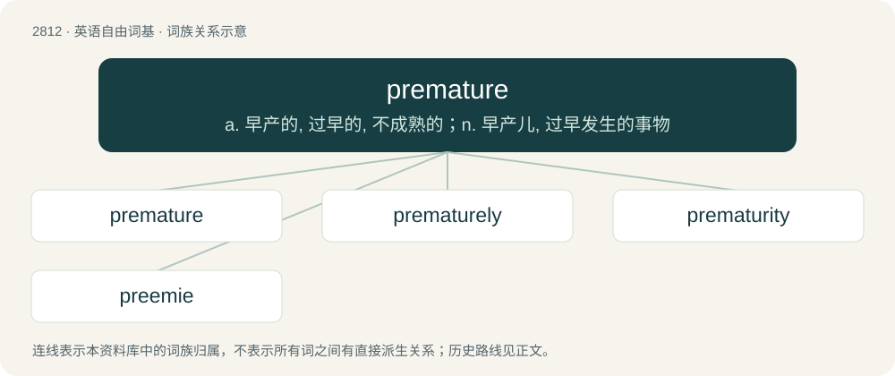

# 2919 · premature — a. 早产的, 过早的, 不成熟的；n. 早产儿, 过早发生的事物

[总目录](../00_总目录_按常用程度.md)

**类型**：英语自由词基　｜　**来源语言**：见词源记录

## 核心含义与来源

- 核心含义：a. 早产的, 过早的, 不成熟的；n. 早产儿, 过早发生的事物
- 英文含义：Occurring before a state of readiness or maturity has arrived.
- 词形：premature

**来源记录 1**（形容词；Occurring before a state of readiness or maturity has arrived.）

From Latin praemātūrus, equivalent to pre- + mature. First use appears c. 1440 in a translation of Palladius's De Re Rustica.

## 词族图

## 单词速览（常用到不常用）

| 单词 | 音标 | 释义 |
|---|---|---|
| [premature](#w-1) | 英 /ˌpɹɛ.məˈtjʊə/；美 /ˌpɹi.məˈtʊɹ/ | a. 早产的, 过早的, 不成熟的；n. 早产儿, 过早发生的事物 |
| [prematurely](#w-2) | /ˌpɹiːməˈtjʊə(ɹ)li/ | adv. 过早地, 贸然地 |
| [prematurity](#w-3) | /.preməˈtjuərəti/ | n. 提早, 早熟, 过早, 不成熟, 早产；\[医\] 早熟 |
| [preemie](#w-4) | /ˈpɹiːmi/ | n. 早产婴孩 |

## 逐词详解

### 1. premature

**词性**：形容词　｜　**音标**：英 /ˌpɹɛ.məˈtjʊə/；美 /ˌpɹi.məˈtʊɹ/

**中文释义**：a. 早产的, 过早的, 不成熟的；n. 早产儿, 过早发生的事物

**英文义项**：Occurring before a state of readiness or maturity has arrived. / Taking place earlier than anticipated, prepared for, or desired.

**构词拆分**：pre- + mature

**词源与演化**：

From Latin praemātūrus, equivalent to pre- + mature. First use appears c. 1440 in a translation of Palladius's De Re Rustica.

**用法示例／搭配（非完整句）**：

> premature reports of the singer's death

该用例对应义项：Occurring before a state of readiness or maturity has arrived.

### 2. prematurely

**词性**：副词　｜　**音标**：/ˌpɹiːməˈtjʊə(ɹ)li/

**中文释义**：adv. 过早地, 贸然地

**英文义项**：In a premature manner; too soon or too early.

**构词拆分**：premature + -ly

**词源与演化**：

From premature + -ly.

**用法示例／搭配（非完整句）**：

> publish an obituary prematurely

该用例对应义项：In a premature manner; too soon or too early.

### 3. prematurity

**词性**：名词　｜　**音标**：/.preməˈtjuərəti/

**中文释义**：n. 提早, 早熟, 过早, 不成熟, 早产；\[医\] 早熟

**英文义项**：The condition of (a baby, etc.) being premature. / Something that is premature or occurs prematurely.

**构词拆分**：premature + -ity

**词源与演化**：

From premature + -ity.

### 4. preemie

**词性**：名词　｜　**音标**：/ˈpɹiːmi/

**中文释义**：n. 早产婴孩

**英文义项**：A baby that has been born prematurely.

**构词拆分**：From prem(ature) + -ie.

**词源与演化**：

From prem(ature) + -ie.

**例句**：

> Tom was born as a preemie.
