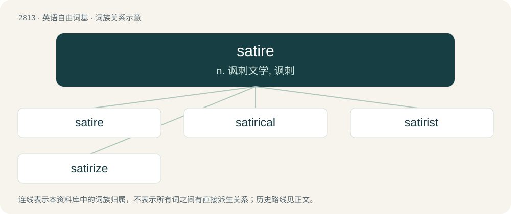

# 2920 · satire — n. 讽刺文学, 讽刺

[总目录](../00_总目录_按常用程度.md)

**类型**：英语自由词基　｜　**来源语言**：见词源记录

## 核心含义与来源

- 核心含义：n. 讽刺文学, 讽刺
- 英文含义：A literary device of writing or art which principally ridicules its subject often as an intended means of provoking or preventing change or highlighting a shortcoming in the work of another. Imitation, humor, irony, and exaggeration are often used to aid this.
- 词形：satire

**来源记录 1**（名词；A literary device of writing or art which principally ridicules its subject often as an intended means of provoking or preventing change or highlighting a shortcoming in the work of another. Imitation, humor, irony, and exaggeration are often used to aid this.）

From Middle French satire, from Old French, from Latin satira, from earlier satura, from lanx satura (“full dish”), from feminine of satur. Altered in Latin by influence of Ancient Greek σάτυρος (sáturos, “satyr”), on the mistaken notion that the form is related to the Greek σατυρικὸν δράμα (saturikòn dráma, “satyr drama”).

## 词族图

## 单词速览（常用到不常用）

| 单词 | 音标 | 释义 |
|---|---|---|
| [satire](#w-1) | 英 /ˈsætaɪə/；美 /ˈsætaɪɹ/ | n. 讽刺文学, 讽刺 |
| [satirical](#w-2) | /səˈtɪɹɪkəl/ | a. 讽刺的, 讥讽的, 好挖苦的, 写讽刺作品的 |
| [satirist](#w-3) | /ˈsætərist/ | n. 讽刺作者, 爱挖苦的人 |
| [satirize](#w-4) | /ˈsatɪrʌɪz/ | vt. 讽刺, 挖苦；vi. 写讽刺作品 |

## 逐词详解

### 1. satire

**词性**：名词　｜　**音标**：英 /ˈsætaɪə/；美 /ˈsætaɪɹ/

**中文释义**：n. 讽刺文学, 讽刺

**英文义项**：A literary device of writing or art which principally ridicules its subject often as an intended means of provoking or preventing change or highlighting a shortcoming in the work of another. Imitation, humor, irony, and exaggeration are often used to aid this. / A satirical work.

**词源与演化**：

From Middle French satire, from Old French, from Latin satira, from earlier satura, from lanx satura (“full dish”), from feminine of satur. Altered in Latin by influence of Ancient Greek σάτυρος (sáturos, “satyr”), on the mistaken notion that the form is related to the Greek σατυρικὸν δράμα (saturikòn dráma, “satyr drama”).

**例句**：

> a stinging satire of American politics.

该用例对应义项：A satirical work.

### 2. satirical

**词性**：形容词　｜　**音标**：/səˈtɪɹɪkəl/

**中文释义**：a. 讽刺的, 讥讽的, 好挖苦的, 写讽刺作品的

**英文义项**：Of, pertaining to, or connected with satire.

**构词拆分**：satire + -ical

**词源与演化**：

From satire + -ical.

**例句**：

> Spitting Image was a famous satirical television program.

该用例对应义项：Of, pertaining to, or connected with satire.

### 3. satirist

**词性**：名词　｜　**音标**：/ˈsætərist/

**中文释义**：n. 讽刺作者, 爱挖苦的人

**英文义项**：A person who writes satire.

**构词拆分**：satire + -ist

**词源与演化**：

From satire + -ist.

### 4. satirize

**词性**：动词　｜　**音标**：/ˈsatɪrʌɪz/

**中文释义**：vt. 讽刺, 挖苦；vi. 写讽刺作品

**英文义项**：To make a satire of; to mock.

**构词拆分**：satire + -ize

**词源与演化**：

From satire + -ize.
