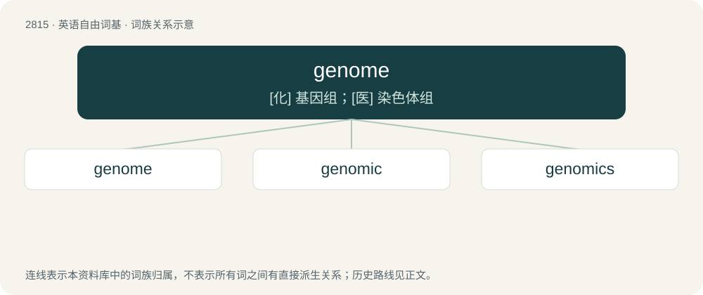

# 2922 · genome — \[化\] 基因组；\[医\] 染色体组

[总目录](../00_总目录_按常用程度.md)

**类型**：英语自由词基　｜　**来源语言**：见词源记录

## 核心含义与来源

- 核心含义：\[化\] 基因组；\[医\] 染色体组
- 英文含义：The complete genetic information (either DNA or, in some viruses, RNA) of an organism.
- 词形：genome

**来源记录 1**（名词；The complete genetic information (either DNA or, in some viruses, RNA) of an organism.）

From earlier genom, from German Genom, coined by German botanist Hans Winkler in 1920 as a blend of Gen (“gene”) + Chromosom (“chromosome”). By surface analysis, gen(e) + -ome, or a blend of gen(e) + (chromos)ome. Spelling altered to reflect the surface analysis.

## 词族图

## 单词速览（常用到不常用）

| 单词 | 音标 | 释义 |
|---|---|---|
| [genome](#w-1) | 英 /ˈd͡ʒiː.nəʊm/；美 /ˈd͡ʒiː.noʊm/ | \[化\] 基因组；\[医\] 染色体组 |
| [genomic](#w-2) | /dʒiːˈŋəʊmɪk/ | 染色体组的 |
| [genomics](#w-3) | /dʒəˈnəʊmɪks/ | 基因组学 |

## 逐词详解

### 1. genome

**词性**：名词　｜　**音标**：英 /ˈd͡ʒiː.nəʊm/；美 /ˈd͡ʒiː.noʊm/

**中文释义**：\[化\] 基因组；\[医\] 染色体组

**英文义项**：The complete genetic information (either DNA or, in some viruses, RNA) of an organism.

**构词拆分**：By surface analysis, gen(e) + -ome

**词源与演化**：

From earlier genom, from German Genom, coined by German botanist Hans Winkler in 1920 as a blend of Gen (“gene”) + Chromosom (“chromosome”). By surface analysis, gen(e) + -ome, or a blend of gen(e) + (chromos)ome. Spelling altered to reflect the surface analysis.

**例句**：

> The human genome contains approximately three billion chemical base pairs.

该用例对应义项：the ordering of genes in a haploid set of chromosomes of a particular organism; the full DNA sequence of an organism

### 2. genomic

**词性**：形容词　｜　**音标**：/dʒiːˈŋəʊmɪk/

**中文释义**：染色体组的

**英文义项**：Of or pertaining to a genome.

**构词拆分**：genome + -ic

**词源与演化**：

From genome + -ic.

**例句**：

> Scientists discover genomic exchange between a vampire-like parasitic plant and its host.

### 3. genomics

**词性**：名词　｜　**音标**：/dʒəˈnəʊmɪks/

**中文释义**：基因组学

**英文义项**：The study of the complete genome of an organism.

**构词拆分**：gene + -omics；genome + -ics

**词源与演化**：

From gene + -omics or genome + -ics.

**例句**：

> Recently, the American Museum of Natural History established the Institute for Comparative Genomics.
