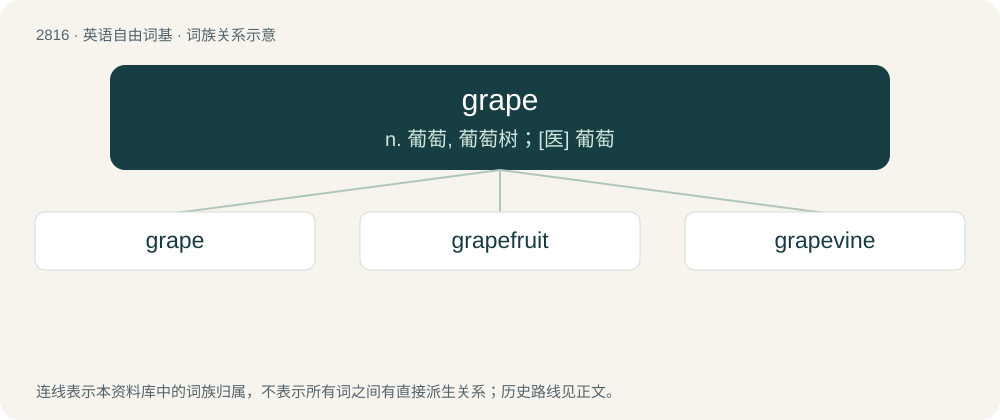

# 2923 · grape — n. 葡萄, 葡萄树；\[医\] 葡萄

[总目录](../00_总目录_按常用程度.md)

**类型**：英语自由词基　｜　**来源语言**：见词源记录

## 核心含义与来源

- 核心含义：n. 葡萄, 葡萄树；\[医\] 葡萄
- 英文含义：A small, round, smooth-skinned edible fruit, usually purple, red, or green, that grows in bunches on female vines of most species of genus Vitis and the self-fertile plants of species Vitis vinifera.
- 词形：grape

**多个词源／构词路径**：同一拼写可能有不同来源；以下按词性和含义分别列出。

**来源记录 1**（名词；A small, round, smooth-skinned edible fruit, usually purple, red, or green, that grows in bunches on female vines of most species of genus Vitis and the self-fertile plants of species Vitis vinifera.）

Inherited from Middle English grape, borrowed from Old French grappe (“cluster of fruit or flowers, bunch of grapes”), deverbal from graper (“to pick grapes”, literally “to hook”), borrowed from Frankish \*krappō (“to hook”), from Proto-Indo-European \*greb- (“hook”) or \*gremb- (“crooked, uneven”), from \*ger- (“to turn, bend, twist”) Displaced Old English wīnberġe (“grape”, literally “wine-berry”). Cognate with Middle Dutch krappe (“hook”), Old High German krapfo (“hook”) (whence German Krapfen (“Berliner doughnut”). Doublet of grappa. More at cramp.

**来源记录 2**（名词；Filter-avoidance spelling of rape.）

From rape, influenced by grape.

## 词族图

## 单词速览（常用到不常用）

| 单词 | 音标 | 释义 |
|---|---|---|
| [grape](#w-1) | 英 /ɡɹeɪp/ | n. 葡萄, 葡萄树；\[医\] 葡萄 |
| [grapefruit](#w-2) | 英 /ˈɡɹeɪ̯pfɹuːt/；美 /ˈɡɹeɪ̯pfɹut/ | n. 葡萄轴 |
| [grapevine](#w-3) | 英 /ˈɡɹeɪp.vaɪn/ | n. 葡萄藤, 葡萄树, 秘密情报网 |

## 逐词详解

### 1. grape

**词性**：名词　｜　**音标**：英 /ɡɹeɪp/

**中文释义**：n. 葡萄, 葡萄树；\[医\] 葡萄

**英文义项**：A small, round, smooth-skinned edible fruit, usually purple, red, or green, that grows in bunches on female vines of most species of genus Vitis and the self-fertile plants of species Vitis vinifera. / Any woody vine of genus Vitis that bears clusters of grapes; a grapevine.

**词源与演化**：

Inherited from Middle English grape, borrowed from Old French grappe (“cluster of fruit or flowers, bunch of grapes”), deverbal from graper (“to pick grapes”, literally “to hook”), borrowed from Frankish \*krappō (“to hook”), from Proto-Indo-European \*greb- (“hook”) or \*gremb- (“crooked, uneven”), from \*ger- (“to turn, bend, twist”) Displaced Old English wīnberġe (“grape”, literally “wine-berry”). Cognate with Middle Dutch krappe (“hook”), Old High German krapfo (“hook”) (whence German Krapfen (“Berliner doughnut”). Doublet of grappa. More at cramp.

**例句**：

> For those seeking purply tones, the paint colors available include mauve, magenta, and grape.

该用例对应义项：A dark purplish-red colour, the colour of many grapes.

### 2. grapefruit

**词性**：名词　｜　**音标**：英 /ˈɡɹeɪ̯pfɹuːt/；美 /ˈɡɹeɪ̯pfɹut/

**中文释义**：n. 葡萄轴

**英文义项**：The tree of the species Citrus paradisi, a hybrid of Citrus maxima and sweet orange. / The large spherical tart fruit produced by this tree.

**构词拆分**：grape + fruit + greatfruit；grape + fruit

**词源与演化**：

Widely assumed to be a marketing term from grape + fruit, an allusion to the supposed grapelike clusters of fruit on the tree, early 19th c. Ciardi proposes another theory: one of the pomelo's botanical names is Citrus grandis, meaning “great citrus \[fruit\]”, due to the size of its fruit. A new pomelo variety might first have been called a GRAYT-froot (see greatfruit), and through the process of assimilation, the word came to be pronounced GRAYP-froot.

**例句**：

> Cupping her grapefruits in her hands, she closed her eyes and imagined her date grasping them, exploring their size, weight, and firmness.

该用例对应义项：Large breasts; by extension, a woman with large breasts.

### 3. grapevine

**词性**：名词　｜　**音标**：英 /ˈɡɹeɪp.vaɪn/

**中文释义**：n. 葡萄藤, 葡萄树, 秘密情报网

**英文义项**：The plant, a vine of genus Vitis, on which grapes grow. / An informal person-to-person means of circulating information or gossip.

**构词拆分**：grape + vine

**词源与演化**：

From grape + vine.

**例句**：

> Although many grapevines have geographical names, these rarely reflect their real origin, if known at all.

该用例对应义项：The plant, a vine of genus Vitis, on which grapes grow.
