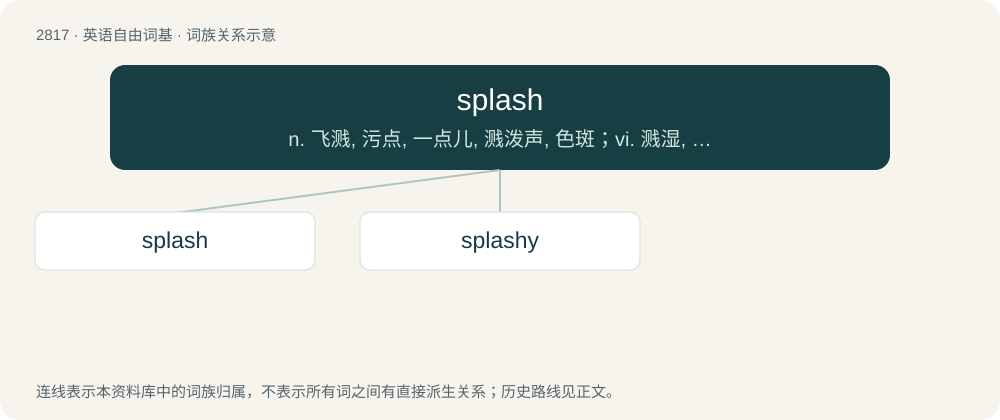

# 2924 · splash — n. 飞溅, 污点, 一点儿, 溅泼声, 色斑；vi. 溅湿, 溅开, 飞溅；vt. 溅, 泼, 使溅起水, 洒, 使成斑驳状

[总目录](../00_总目录_按常用程度.md)

**类型**：英语自由词基　｜　**来源语言**：见词源记录

## 核心含义与来源

- 核心含义：n. 飞溅, 污点, 一点儿, 溅泼声, 色斑；vi. 溅湿, 溅开, 飞溅；vt. 溅, 泼, 使溅起水, 洒, 使成斑驳状
- 英文含义：The sound made by an object hitting a liquid.
- 词形：splash

**来源记录 1**（名词；The sound made by an object hitting a liquid.）

Probably an alteration of plash (compare spatter, spill for the initial s-).

## 词族图

## 单词速览（常用到不常用）

| 单词 | 音标 | 释义 |
|---|---|---|
| [splash](#w-1) | /splæʃ/ | n. 飞溅, 污点, 一点儿, 溅泼声, 色斑；vi. 溅湿, 溅开, 飞溅；vt. 溅, 泼, 使溅起水, 洒, 使成斑驳状 |
| [splashy](#w-2) | /ˈsplæʃi/ | a. 容易溅开的, 泥泞的, 遍布斑点的 |

## 逐词详解

### 1. splash

**词性**：名词　｜　**音标**：/splæʃ/

**中文释义**：n. 飞溅, 污点, 一点儿, 溅泼声, 色斑；vi. 溅湿, 溅开, 飞溅；vt. 溅, 泼, 使溅起水, 洒, 使成斑驳状

**英文义项**：The sound made by an object hitting a liquid. / A small amount of liquid.

**词源与演化**：

Probably an alteration of plash (compare spatter, spill for the initial s-).

**例句**：

> I felt a splash of water on my leg as the car drove into the nearby puddle.

该用例对应义项：A small amount of liquid.

### 2. splashy

**词性**：形容词　｜　**音标**：/ˈsplæʃi/

**中文释义**：a. 容易溅开的, 泥泞的, 遍布斑点的

**英文义项**：Relating to making splashes or the sound of splashing. / Full of dirty water; muddy and wet.

**构词拆分**：splash + -y

**词源与演化**：

From splash + -y.

**例句**：

> His splashy car was supposed to show his wealth, but instead it showed his poor taste.

该用例对应义项：Ostentatious, showy.
