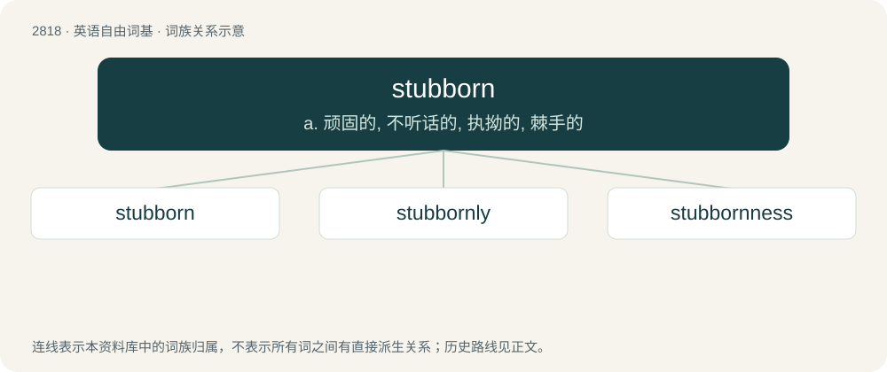

# 2925 · stubborn — a. 顽固的, 不听话的, 执拗的, 棘手的

[总目录](../00_总目录_按常用程度.md)

**类型**：英语自由词基　｜　**来源语言**：见词源记录

## 核心含义与来源

- 核心含义：a. 顽固的, 不听话的, 执拗的, 棘手的
- 英文含义：Refusing to move or to change one's opinion; obstinate; firmly resisting; persistent in doing something.
- 词形：stubborn

**来源记录 1**（形容词；Refusing to move or to change one's opinion; obstinate; firmly resisting; persistent in doing something.）

From Middle English stiborne, stibourne, stoburn, stoburne, styburne, stiborn, of uncertain origin; one hypothesis is that it may be from Old English \*stybbor, from Old English stybb (“a stump, stub”) + -or (adjective-formation suffix, as in bitor, whence English bitter).

## 词族图

## 单词速览（常用到不常用）

| 单词 | 音标 | 释义 |
|---|---|---|
| [stubborn](#w-1) | 英 /ˈstʌbən/；美 /ˈstʌbɚn/ | a. 顽固的, 不听话的, 执拗的, 棘手的 |
| [stubbornly](#w-2) |  | adv. 倔强地；顽固地 |
| [stubbornness](#w-3) | 英 /ˈstʌbən(n)əs/；美 /ˈstʌbɚn(n)əs/ | n. 倔强；顽强；棘手 |

## 逐词详解

### 1. stubborn

**词性**：形容词　｜　**音标**：英 /ˈstʌbən/；美 /ˈstʌbɚn/

**中文释义**：a. 顽固的, 不听话的, 执拗的, 棘手的

**英文义项**：Refusing to move or to change one's opinion; obstinate; firmly resisting; persistent in doing something. / Physically stiff and inflexible; not easily melted or worked.

**词源与演化**：

From Middle English stiborne, stibourne, stoburn, stoburne, styburne, stiborn, of uncertain origin; one hypothesis is that it may be from Old English \*stybbor, from Old English stybb (“a stump, stub”) + -or (adjective-formation suffix, as in bitor, whence English bitter).

**例句**：

> People are pretty stubborn about their political beliefs, so why bother arguing?

该用例对应义项：Refusing to move or to change one's opinion; obstinate; firmly resisting; persistent in doing something.

### 2. stubbornly

**词性**：副词

**中文释义**：adv. 倔强地；顽固地

**英文义项**：In a stubborn manner.

**构词拆分**：stubborn + -ly

**词源与演化**：

From stubborn + -ly.

**例句**：

> He stubbornly refused to quit trying, even after failing 20 times.

该用例对应义项：In a stubborn manner.

### 3. stubbornness

**词性**：名词　｜　**音标**：英 /ˈstʌbən(n)əs/；美 /ˈstʌbɚn(n)əs/

**中文释义**：n. 倔强；顽强；棘手

**英文义项**：The state of being stubborn.

**构词拆分**：stubborn + -ness

**词源与演化**：

From stubborn + -ness.

**例句**：

> There is no way of curing the stubbornness of the racists.
