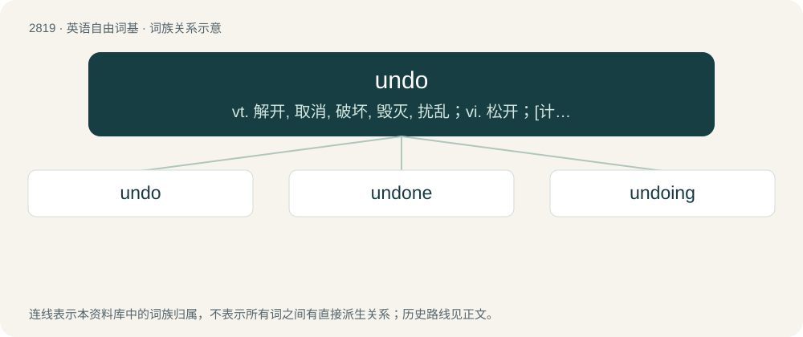

# 2926 · undo — vt. 解开, 取消, 破坏, 毁灭, 扰乱；vi. 松开；\[计\] 撤消

[总目录](../00_总目录_按常用程度.md)

**类型**：英语自由词基　｜　**来源语言**：见词源记录

## 核心含义与来源

- 核心含义：vt. 解开, 取消, 破坏, 毁灭, 扰乱；vi. 松开；\[计\] 撤消
- 英文含义：To reverse the effects of an action.
- 词形：undo

**来源记录 1**（动词；To reverse the effects of an action.）

From Middle English undōn, from Old English ondōn, from Proto-West Germanic \*andadōn (“to undo”), equivalent to un- + do. Cognate with West Frisian ûndwaan, ûntdwaan (“to undo; rid”), Dutch ontdoen (“to undo”).

## 词族图

## 单词速览（常用到不常用）

| 单词 | 音标 | 释义 |
|---|---|---|
| [undo](#w-1) | 英 /ʌnˈduː/ | vt. 解开, 取消, 破坏, 毁灭, 扰乱；vi. 松开；\[计\] 撤消 |
| [undone](#w-2) | /ʌnˈdʌn/ | 【英文】Not fastened. |
| [undoing](#w-3) | /ʌnˈduːɪŋ/ | n. 毁灭, 取消 |

## 逐词详解

### 1. undo

**词性**：动词　｜　**音标**：英 /ʌnˈduː/

**中文释义**：vt. 解开, 取消, 破坏, 毁灭, 扰乱；vi. 松开；\[计\] 撤消

**英文义项**：To reverse the effects of an action. / To unfasten.

**构词拆分**：un- + do

**词源与演化**：

From Middle English undōn, from Old English ondōn, from Proto-West Germanic \*andadōn (“to undo”), equivalent to un- + do. Cognate with West Frisian ûndwaan, ûntdwaan (“to undo; rid”), Dutch ontdoen (“to undo”).

**例句**：

> Fortunately, we can undo most of the damage to the system by the war.

该用例对应义项：To reverse the effects of an action.

### 2. undone

**词性**：形容词　｜　**音标**：/ʌnˈdʌn/

**英文义项**：Not fastened. / Ruined; brought to nought.

**构词拆分**：undo + -en (past participle ending)

**词源与演化**：

From Middle English undon, from Old English ondōn, from Proto-Germanic \*andadōnaz, past participle of \*andadōną (“to undo”), equivalent to undo + -en (past participle ending). Cognate with Dutch ontdaan (“stripped, undone, upset”).

**例句**：

> Woe is me, for I am utterly undone!

该用例对应义项：Ruined; brought to nought.

### 3. undoing

**词性**：名词　｜　**音标**：/ʌnˈduːɪŋ/

**中文释义**：n. 毁灭, 取消

**英文义项**：The act of loosening or unfastening / Ruin; defeat, (also) that which causes defeat or ruin.

**构词拆分**：undo + -ing

**词源与演化**：

From Middle English undoinge, undoynge, ondoynge; equivalent to undo + -ing.

**例句**：

> In the end, his jealousy was his undoing.

该用例对应义项：Ruin; defeat, (also) that which causes defeat or ruin.
