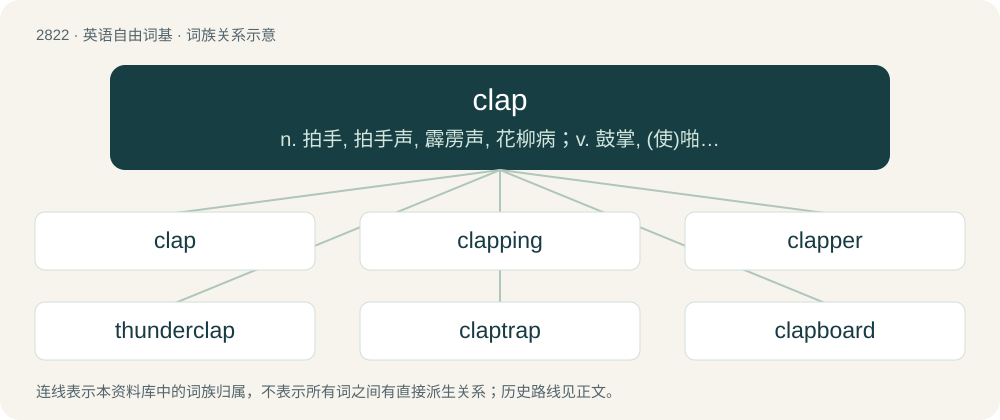

# 2927 · clap — n. 拍手, 拍手声, 霹雳声, 花柳病；v. 鼓掌, (使)啪地关上

[总目录](../00_总目录_按常用程度.md)

**类型**：英语自由词基　｜　**来源语言**：见词源记录

## 核心含义与来源

- 核心含义：n. 拍手, 拍手声, 霹雳声, 花柳病；v. 鼓掌, (使)啪地关上
- 英文含义：The act of striking the palms of the hands, or any two surfaces, together.
- 词形：clap

**多个词源／构词路径**：同一拼写可能有不同来源；以下按词性和含义分别列出。

**来源记录 1**（名词；The act of striking the palms of the hands, or any two surfaces, together.）

From Middle English clappen, from Old English clæppan, \*clappian, from Proto-West Germanic \*klappijan, \*klappōn, from Proto-Germanic \*klappōną (“to clap”). Cognate with Dutch klappen, Icelandic klappa, Faroese klappa and Danish klappe.

**来源记录 2**（名词；Synonym of gonorrhea.）

Uncertain. Probably from Old French clapoir (“bubo, inflammation from infection”), from clapier (“brothel”). May also be from old, unsafe treatments for gonorrhea, such as clapping the penis between a book and a hard surface to break up obstructions in the urethra and permit urination. Attested from the 16th century.

## 词族图

## 单词速览（常用到不常用）

| 单词 | 音标 | 释义 |
|---|---|---|
| [clap](#w-1) | /klæp/ | n. 拍手, 拍手声, 霹雳声, 花柳病；v. 鼓掌, (使)啪地关上 |
| [clapping](#w-2) | /ˈklæpɪŋ/ | n. 掌声, 拍手声；\[医\] 拍打法(按摩的一种手法) |
| [clapper](#w-3) | 美 /ˈklæpɚ/ | n. 拍手者, 铃锤, 钟锤；\[电\] 铃锤 |
| [thunderclap](#w-4) | 美 /ˈθʌndɚˌklæp/ | n. 雷声, 霹雳, 晴天霹雳 |
| [claptrap](#w-5) | 英 /ˈklæpˌtɹæp/ | n. 哗众取宠的空话(花招)；a. 哗众取宠的 |
| [clapboard](#w-6) | /ˈklæpˌbɔː(ɹ)d/ | 【英文】A clapperboard; a device used in film production, having hinged boards that are brought together with a clap, used to synchronize picture and sound at the start of each take of a motion picture or other video product |

## 逐词详解

### 1. clap

**词性**：名词　｜　**音标**：/klæp/

**中文释义**：n. 拍手, 拍手声, 霹雳声, 花柳病；v. 鼓掌, (使)啪地关上

**英文义项**：The act of striking the palms of the hands, or any two surfaces, together. / The explosive sound of thunder.

**词源与演化**：

From Middle English clappen, from Old English clæppan, \*clappian, from Proto-West Germanic \*klappijan, \*klappōn, from Proto-Germanic \*klappōną (“to clap”). Cognate with Dutch klappen, Icelandic klappa, Faroese klappa and Danish klappe.

**例句**：

> His father's affection never went further than a handshake or a clap on the shoulder.

该用例对应义项：A slap with the hand, usually in a jovial manner.

### 2. clapping

**词性**：名词　｜　**音标**：/ˈklæpɪŋ/

**中文释义**：n. 掌声, 拍手声；\[医\] 拍打法(按摩的一种手法)

**英文义项**：The action by which someone or something claps.

**构词拆分**：clap + -ing

**词源与演化**：

From Middle English clappynge; equivalent to clap + -ing.

**例句**：

> Inside the venue, sounds of clapping, whistling, yelling, laughing blended together.

### 3. clapper

**词性**：名词　｜　**音标**：美 /ˈklæpɚ/

**中文释义**：n. 拍手者, 铃锤, 钟锤；\[电\] 铃锤

**英文义项**：One who claps; a person who applauds by clapping the hands. / An object so suspended inside a bell that it may hit the bell and cause it to ring; a clanger or tongue.

**构词拆分**：clap + -er

**词源与演化**：

From clap + -er.

### 4. thunderclap

**词性**：名词　｜　**音标**：美 /ˈθʌndɚˌklæp/

**中文释义**：n. 雷声, 霹雳, 晴天霹雳

**英文义项**：A sudden, loud thunder caused by a nearby lightning strike; a shock of thunder, as opposed to a reverberating rumble. / A very loud fart.

**构词拆分**：thunder + clap

**词源与演化**：

From thunder + clap.

**例句**：

> After the thunderclap, the rain began pouring down.

### 5. claptrap

**词性**：名词　｜　**音标**：英 /ˈklæpˌtɹæp/

**中文释义**：n. 哗众取宠的空话(花招)；a. 哗众取宠的

**英文义项**：Empty verbiage or nonsense. / A device or trick to gain applause; a humbug.

**构词拆分**：clap + trap

**词源与演化**：

Theater slang, c. 1730, from clap + trap, referring to theatrical techniques or gags used to incite applause.

**例句**：

> The mayor and his companion have been uttering a lot of claptrap to the citizens for a long time.

### 6. clapboard

**词性**：名词　｜　**音标**：/ˈklæpˌbɔː(ɹ)d/

**英文义项**：A clapperboard; a device used in film production, having hinged boards that are brought together with a clap, used to synchronize picture and sound at the start of each take of a motion picture or other video production.

**构词拆分**：clap + board

**词源与演化**：

From clap + board.
