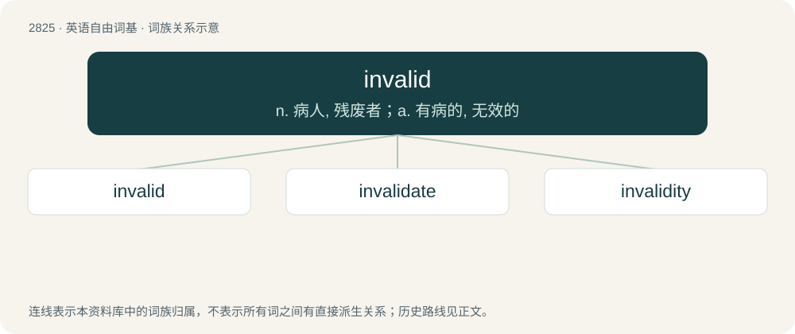

# 2932 · invalid — n. 病人, 残废者；a. 有病的, 无效的

[总目录](../00_总目录_按常用程度.md)

**类型**：英语自由词基　｜　**来源语言**：见词源记录

## 核心含义与来源

- 核心含义：n. 病人, 残废者；a. 有病的, 无效的
- 英文含义：Not valid; not true, correct, acceptable, or appropriate.
- 词形：invalid

**多个词源／构词路径**：同一拼写可能有不同来源；以下按词性和含义分别列出。

**来源记录 1**（形容词；Not valid; not true, correct, acceptable, or appropriate.）

From in- + valid.

**来源记录 2**（名词；Any person with a disability or illness.）

Borrowed from Middle French invalide, from Latin invalidus (“infirm, weak”), from in- (“not”) + validus (“strong”).

## 词族图

## 单词速览（常用到不常用）

| 单词 | 音标 | 释义 |
|---|---|---|
| [invalid](#w-1) | /ɪnˈvæl.ɪd/ | n. 病人, 残废者；a. 有病的, 无效的 |
| [invalidate](#w-2) | 英 /ɪnˈvæl.ɪ.deɪt/；美 /ɪnˈvæl.əˌdeɪt/ | vt. 使无效；\[法\] 使无效, 使无效力, 使作废 |
| [invalidity](#w-3) | /.invəˈliditi/ | n. 无效, 无价值, 病弱；\[医\] 病废, 劳动能力丧失 |

## 逐词详解

### 1. invalid

**词性**：形容词　｜　**音标**：/ɪnˈvæl.ɪd/

**中文释义**：n. 病人, 残废者；a. 有病的, 无效的

**英文义项**：Not valid; not true, correct, acceptable, or appropriate.

**构词拆分**：in- + valid

**词源与演化**：

From in- + valid.

**例句**：

> Your argument is invalid because it uses circular reasoning.

该用例对应义项：Not valid; not true, correct, acceptable, or appropriate.

### 2. invalidate

**词性**：动词　｜　**音标**：英 /ɪnˈvæl.ɪ.deɪt/；美 /ɪnˈvæl.əˌdeɪt/

**中文释义**：vt. 使无效；\[法\] 使无效, 使无效力, 使作废

**英文义项**：To make invalid (especially in to contract law) / To make or declare (an argument, statement, or theory) unsound or erroneous; disprove.

**构词拆分**：invalid + -ate

**词源与演化**：

First attested in 1649; borrowed from Middle French invalider, from invalide + -er. By surface analysis, in- + validate or invalid + -ate.

**例句**：

> Telling an angry person to "calm down" can invalidate their feelings.

该用例对应义项：To render invalid; discredit.

### 3. invalidity

**词性**：名词　｜　**音标**：/.invəˈliditi/

**中文释义**：n. 无效, 无价值, 病弱；\[医\] 病废, 劳动能力丧失

**英文义项**：The state of being invalid; lack of validity.

**构词拆分**：invalid + -ity

**词源与演化**：

From invalid + -ity.
