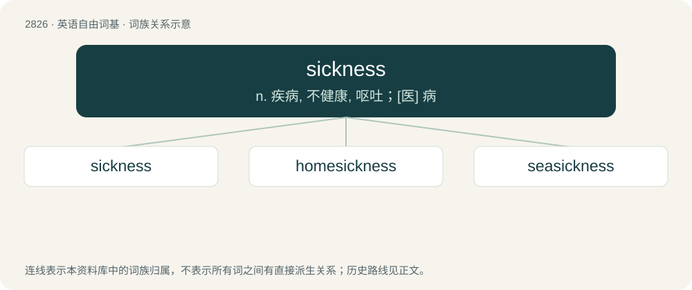

# 2934 · sickness — n. 疾病, 不健康, 呕吐；\[医\] 病

[总目录](../00_总目录_按常用程度.md)

**类型**：英语自由词基　｜　**来源语言**：见词源记录

## 核心含义与来源

- 核心含义：n. 疾病, 不健康, 呕吐；\[医\] 病
- 英文含义：The quality or state of being sick or diseased; illness; an illness.
- 词形：sickness

**来源记录 1**（名词；The quality or state of being sick or diseased; illness; an illness.）

Inherited from Middle English sikness, from Old English sēocnes, sēocness, sēocnys, sēocnyss. By surface analysis, sick + -ness.

## 词族图

## 单词速览（常用到不常用）

| 单词 | 音标 | 释义 |
|---|---|---|
| [sickness](#w-1) | /ˈsɪknɪs/ | n. 疾病, 不健康, 呕吐；\[医\] 病 |
| [homesickness](#w-2) |  | n. 乡愁 |
| [seasickness](#w-3) | /ˈsiːsɪk.nəs/ | \[医\] 晕船 |

## 逐词详解

### 1. sickness

**词性**：名词　｜　**音标**：/ˈsɪknɪs/

**中文释义**：n. 疾病, 不健康, 呕吐；\[医\] 病

**英文义项**：The quality or state of being sick or diseased; illness; an illness. / Nausea; qualmishness; as, sickness of stomach.

**词源与演化**：

Inherited from Middle English sikness, from Old English sēocnes, sēocness, sēocnys, sēocnyss. By surface analysis, sick + -ness.

**例句**：

> There has been a lot of sickness in my family this winter.

### 2. homesickness

**词性**：名词

**中文释义**：n. 乡愁

**英文义项**：The characteristic of being homesick; a strong, sad feeling of missing one's home (and often left-behind loved ones, such as family and friends) when physically away.

**构词拆分**：home + sickness

**词源与演化**：

Calque of German Heimweh (“homesickness”, literally “home-woe”), equivalent to home + sickness.

**例句**：

> Homesickness is a longing to go back to where you are from.

### 3. seasickness

**词性**：名词　｜　**音标**：/ˈsiːsɪk.nəs/

**中文释义**：\[医\] 晕船

**英文义项**：Nausea, dizziness, etc. caused by the motion of a ship; a form of motion sickness.

**构词拆分**：seasick + -ness；sea + sickness

**词源与演化**：

From seasick + -ness or sea + sickness. Compare Middle English seknesse of the see (“seasickness”, literally “sickness of the sea”).

**例句**：

> Take seasickness medication at least an hour before you board.
