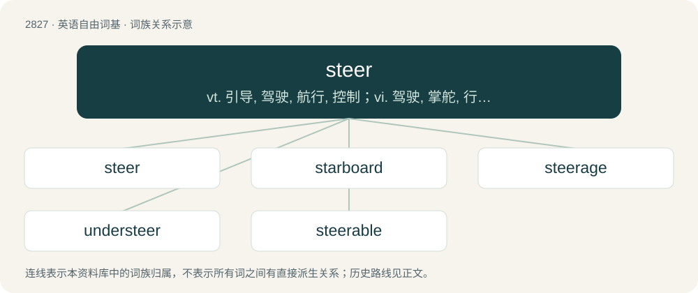

# 2935 · steer — vt. 引导, 驾驶, 航行, 控制；vi. 驾驶, 掌舵, 行驶；n. 驾驶指示, 劝告

[总目录](../00_总目录_按常用程度.md)

**类型**：英语自由词基　｜　**来源语言**：见词源记录

## 核心含义与来源

- 核心含义：vt. 引导, 驾驶, 航行, 控制；vi. 驾驶, 掌舵, 行驶；n. 驾驶指示, 劝告
- 英文含义：To guide the course of a vessel, vehicle, aircraft etc. (by means of a device such as a rudder, paddle, or steering wheel).
- 词形：steer

**多个词源／构词路径**：同一拼写可能有不同来源；以下按词性和含义分别列出。

**来源记录 1**（动词；To guide the course of a vessel, vehicle, aircraft etc. (by means of a device such as a rudder, paddle, or steering wheel).）

Inherited from Middle English steeren, steren, stiren, sturen, steoren, from Old English stēoran, stīeran, stȳran (“to steer; guide a vessel”), from Proto-West Germanic \*stiurijan (“to steer”), from Proto-Germanic \*stiurijaną (“to steer”). The noun is from Middle English steere, stere (“rudder”), steor, from Old English stēor, stȳr (“steering; guidance; direction”). Compare Dutch stuur, German Steuer, Icelandic stýri.

**来源记录 2**（名词；The castrated male of cattle, especially one raised for beef production.）

Inherited from Middle English steer, ster, from Old English stēor (“a young bull or cow; steer”), from Proto-Germanic \*steuraz (“bull; steer”), from Proto-Indo-European \*(s)táwros (“wild bull; aurochs”). Cognate with Dutch stier, German Stier, Icelandic stjór, Latin taurus (“bull”), Greek ταύρος (távros). Doublet of tur and Taurus.

## 词族图

## 单词速览（常用到不常用）

| 单词 | 音标 | 释义 |
|---|---|---|
| [steer](#w-1) | 英 /stɪə/；美 /stɪɹ/ | vt. 引导, 驾驶, 航行, 控制；vi. 驾驶, 掌舵, 行驶；n. 驾驶指示, 劝告 |
| [starboard](#w-2) | 英 /ˈstɑː.bəd/；美 /ˈstɑɹ.bɚd/ | n. 右舷, 右侧；adv. 向右舷；vt. 转向右方, 向右转舵 |
| [steerage](#w-3) | /ˈstiəridʒ/ | n. 统舱, 掌舵, 操纵, 管理 |
| [understeer](#w-4) | /ˈʌndəstiə/ | n. 操纵失灵；\[法\] 转向不足, 对驾驶盘反应迟纯 |
| [steerable](#w-5) |  | a. 易驾驶的, 易操纵的, 易改变位置的；\[计\] 可操纵的, 可控制的 |

## 逐词详解

### 1. steer

**词性**：动词　｜　**音标**：英 /stɪə/；美 /stɪɹ/

**中文释义**：vt. 引导, 驾驶, 航行, 控制；vi. 驾驶, 掌舵, 行驶；n. 驾驶指示, 劝告

**英文义项**：To guide the course of a vessel, vehicle, aircraft etc. (by means of a device such as a rudder, paddle, or steering wheel). / To guide the course of a vessel, vehicle, aircraft etc. (by means of a device such as a rudder, paddle, or steering wheel).

**词源与演化**：

Inherited from Middle English steeren, steren, stiren, sturen, steoren, from Old English stēoran, stīeran, stȳran (“to steer; guide a vessel”), from Proto-West Germanic \*stiurijan (“to steer”), from Proto-Germanic \*stiurijaną (“to steer”). The noun is from Middle English steere, stere (“rudder”), steor, from Old English stēor, stȳr (“steering; guidance; direction”). Compare Dutch stuur, German Steuer, Icelandic stýri.

**例句**：

> When planning the boat trip, we had completely forgotten that we needed somebody to steer.

该用例对应义项：To guide the course of a vessel, vehicle, aircraft etc. (by means of a device such as a rudder, paddle, or steering wheel).

### 2. starboard

**词性**：名词　｜　**音标**：英 /ˈstɑː.bəd/；美 /ˈstɑɹ.bɚd/

**中文释义**：n. 右舷, 右侧；adv. 向右舷；vt. 转向右方, 向右转舵

**英文义项**：The righthand side of a ship, boat or aircraft when facing the front, or fore or bow. Used to unambiguously refer to directions according to the sides of the vessel, rather than those of a crew member or object. / One of the two traditional watches aboard a ship standing a watch in two.

**构词拆分**：steer + board (“side (of a ship)”)

**词源与演化**：

From Middle English sterbord, stere-bourd, stere-burd, from Old English stēorbord, from Proto-West Germanic \*steurubord, equivalent to steer + board (“side (of a ship)”), referring to ancient ships with the steering oar set to the right (to accommodate right-handed crew). Ships had to dock on their left (port) side because the steering oar on the right would get in the way, which is how the left became known as the port side.

**例句**：

> We're on starboard tack, so the other boat has to give way.

该用例对应义项：The righthand side of a ship, boat or aircraft when facing the front, or fore or bow. Used to unambiguously refer to directions according to the sides of the vessel, rather than those of a crew member or object.

### 3. steerage

**词性**：名词　｜　**音标**：/ˈstiəridʒ/

**中文释义**：n. 统舱, 掌舵, 操纵, 管理

**英文义项**：The art of steering. / The section of a passenger ship that provided inexpensive accommodation with no individual cabins.

**构词拆分**：steer + -age

**词源与演化**：

From steer + -age.

### 4. understeer

**词性**：名词　｜　**音标**：/ˈʌndəstiə/

**中文释义**：n. 操纵失灵；\[法\] 转向不足, 对驾驶盘反应迟纯

**英文义项**：The condition in which the front wheels of a car fail to follow the desired curve while cornering, instead following more of a straight-line trajectory, losing a degree of traction, and so slipping off the required line.

**构词拆分**：under- + steer

**词源与演化**：

From under- + steer.

**例句**：

> FWD vehicles have the tendency to understeer.

### 5. steerable

**词性**：形容词

**中文释义**：a. 易驾驶的, 易操纵的, 易改变位置的；\[计\] 可操纵的, 可控制的

**英文义项**：Capable of being steered.

**构词拆分**：steer + -able

**词源与演化**：

From steer + -able.
