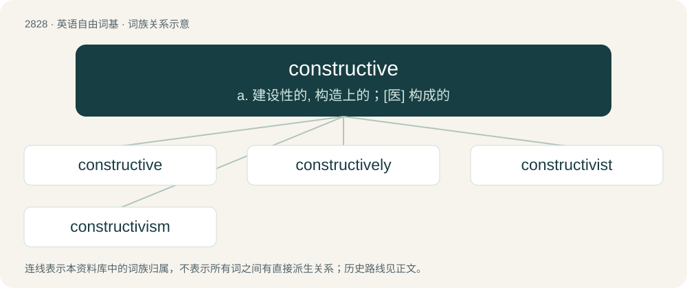

# 2937 · constructive — a. 建设性的, 构造上的；\[医\] 构成的

[总目录](../00_总目录_按常用程度.md)

**类型**：英语自由词基　｜　**来源语言**：见词源记录

## 核心含义与来源

- 核心含义：a. 建设性的, 构造上的；\[医\] 构成的
- 英文含义：Relating to or causing construction.
- 词形：constructive

**来源记录 1**（形容词；Relating to or causing construction.）

From Latin cōnstrūctīvus. By surface analysis, construct + -ive.

## 词族图

## 单词速览（常用到不常用）

| 单词 | 音标 | 释义 |
|---|---|---|
| [constructive](#w-1) | /kənˈstɹʌktɪv/ | a. 建设性的, 构造上的；\[医\] 构成的 |
| [constructively](#w-2) |  | adv. 建设性地 |
| [constructivist](#w-3) | /kənˈstrʌktivist/ | n. 构成派造型艺术家 |
| [constructivism](#w-4) | /kənˈstɹʌktɪvɪzm/ | n. 构成主义, 构成派舞美艺术 |

## 逐词详解

### 1. constructive

**词性**：形容词　｜　**音标**：/kənˈstɹʌktɪv/

**中文释义**：a. 建设性的, 构造上的；\[医\] 构成的

**英文义项**：Relating to or causing construction. / Carefully considered and meant to be helpful.

**词源与演化**：

From Latin cōnstrūctīvus. By surface analysis, construct + -ive.

**用法示例／搭配（非完整句）**：

> constructive dismissal

该用例对应义项：Deemed after the fact to exist or to have occurred, despite the formal process not having been followed; often when there was no intention to do so at the time.

### 2. constructively

**词性**：副词

**中文释义**：adv. 建设性地

**英文义项**：In a constructive manner.

**构词拆分**：constructive + -ly

**词源与演化**：

From constructive + -ly.

**例句**：

> It is my task to look critically and constructively at the flaws and the failures.

该用例对应义项：in a constructive manner

### 3. constructivist

**词性**：形容词　｜　**音标**：/kənˈstrʌktivist/

**中文释义**：n. 构成派造型艺术家

**英文义项**：Of or relating to constructivism.

**构词拆分**：constructive + -ist

**词源与演化**：

From constructive + -ist.

### 4. constructivism

**词性**：名词　｜　**音标**：/kənˈstɹʌktɪvɪzm/

**中文释义**：n. 构成主义, 构成派舞美艺术

**英文义项**：A Russian movement in modern art characterized by the creation of nonrepresentational geometric objects using industrial materials. / A style of modern architecture that flourished in the Soviet Union in the 1920s and early 1930s.

**构词拆分**：constructive + -ism

**词源与演化**：

From constructive + -ism.

**例句**：

> Constructivism was born in Russia around 1920.
