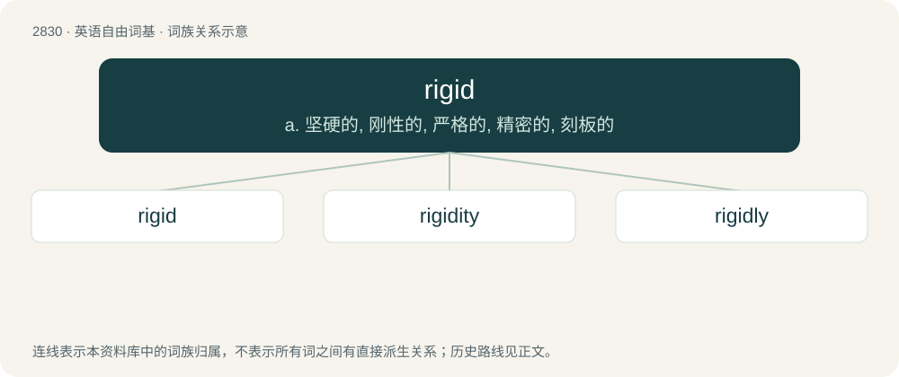

# 2938 · rigid — a. 坚硬的, 刚性的, 严格的, 精密的, 刻板的

[总目录](../00_总目录_按常用程度.md)

**类型**：英语自由词基　｜　**来源语言**：见词源记录

## 核心含义与来源

- 核心含义：a. 坚硬的, 刚性的, 严格的, 精密的, 刻板的
- 英文含义：Stiff, rather than flexible.
- 词形：rigid

**来源记录 1**（形容词；Stiff, rather than flexible.）

From Middle English rigide, from Latin rigidus (“stiff”), from rigeō (“to be stiff”). Compare rigor. Merged with Middle English rigged, rygged, rugged (“upright like a spine, rigid”, literally “ridged”).

## 词族图

## 单词速览（常用到不常用）

| 单词 | 音标 | 释义 |
|---|---|---|
| [rigid](#w-1) | 英 /ˈɹɪd͡ʒ.ɪd/ | a. 坚硬的, 刚性的, 严格的, 精密的, 刻板的 |
| [rigidity](#w-2) | /ɹɪˈd͡ʒɪdɪti/ | n. 坚硬, 僵化, 坚硬, 刚性, 刚度；\[化\] 刚度系数 |
| [rigidly](#w-3) | /ˈɹɪd͡ʒ.ɪd.li/ | adv. 严格地；坚硬地；严厉地；牢牢地 |

## 逐词详解

### 1. rigid

**词性**：形容词　｜　**音标**：英 /ˈɹɪd͡ʒ.ɪd/

**中文释义**：a. 坚硬的, 刚性的, 严格的, 精密的, 刻板的

**英文义项**：Stiff, rather than flexible. / Having inflexible thoughts, opinions, or beliefs.

**词源与演化**：

From Middle English rigide, from Latin rigidus (“stiff”), from rigeō (“to be stiff”). Compare rigor. Merged with Middle English rigged, rygged, rugged (“upright like a spine, rigid”, literally “ridged”).

**例句**：

> Despite arguments to the contrary, she remained rigid in her stand.

该用例对应义项：Uncompromising.

### 2. rigidity

**词性**：名词　｜　**音标**：/ɹɪˈd͡ʒɪdɪti/

**中文释义**：n. 坚硬, 僵化, 坚硬, 刚性, 刚度；\[化\] 刚度系数

**英文义项**：The quality or state of being rigid; lack of pliability; the quality of resisting change of physical shape. / The amount of resistance with which a body opposes change of form.

**构词拆分**：rigid + -ity

**词源与演化**：

From rigid + -ity, from Latin rigiditas.

**例句**：

> The metal’s rigidity made it hard to bend.

该用例对应义项：The quality or state of being rigid; lack of pliability; the quality of resisting change of physical shape.

### 3. rigidly

**词性**：副词　｜　**音标**：/ˈɹɪd͡ʒ.ɪd.li/

**中文释义**：adv. 严格地；坚硬地；严厉地；牢牢地

**英文义项**：In a rigid manner; stiffly.

**构词拆分**：rigid + -ly

**词源与演化**：

From rigid + -ly.

**例句**：

> The body was rigidly erect.

该用例对应义项：in a rigid manner
