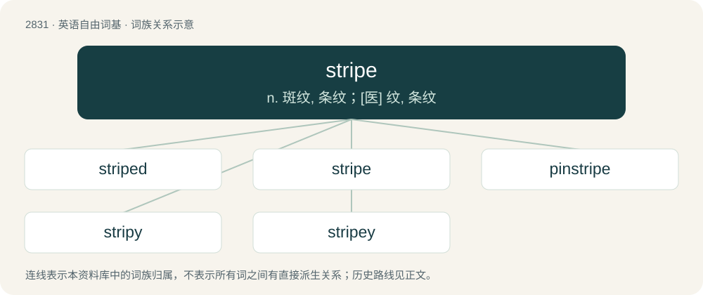

# 2939 · stripe — n. 斑纹, 条纹；\[医\] 纹, 条纹

[总目录](../00_总目录_按常用程度.md)

**类型**：英语自由词基　｜　**来源语言**：见词源记录

## 核心含义与来源

- 核心含义：n. 斑纹, 条纹；\[医\] 纹, 条纹
- 英文含义：A long region of a single colour in a repeating pattern of similar regions.
- 词形：stripe

**来源记录 1**（名词；A long region of a single colour in a repeating pattern of similar regions.）

From Middle English stripe, strype, from Middle Dutch or Middle Low German strîpe, from Proto-West Germanic \*strīpā, \*strīpō, from Proto-Germanic \*strīpô. Cognate with Saterland Frisian Striepe (“stripe, strip”), West Frisian stripe (“stripe”), Dutch streep (“stripe”), German Low German Striepe, Striep, Streep (“stripe”), German Streifen (“stripe, strip, band”), Danish stribe (“stripe”).

## 词族图

## 单词速览（常用到不常用）

| 单词 | 音标 | 释义 |
|---|---|---|
| [striped](#w-1) | /stɹaɪpt/ | a. 有斑纹的 |
| [stripe](#w-2) | 英 /stɹaɪp/；美 /stɹaɪp/ | n. 斑纹, 条纹；\[医\] 纹, 条纹 |
| [pinstripe](#w-3) | /ˈpɪnˌstɹaɪp/ | n. 细条纹, 细条纹布料 |
| [stripy](#w-4) | /ˈstɹaɪp.i/ | a. 有条纹的, 有斑纹的 |
| [stripey](#w-5) |  | 【英文】A marine fish found from Australia to Hawaii and Japan, Microcanthus strigosus, which is sometimes kept in aquaria. |

## 逐词详解

### 1. striped

**词性**：形容词　｜　**音标**：/stɹaɪpt/

**中文释义**：a. 有斑纹的

**英文义项**：Having stripes, decorated or marked with bands differing in color.

**构词拆分**：From stripe + -ed.

**词源与演化**：

From stripe + -ed.

**例句**：

> Jim is the boy in the striped polo.

该用例对应义项：Having stripes, decorated or marked with bands differing in color.

### 2. stripe

**词性**：名词　｜　**音标**：英 /stɹaɪp/；美 /stɹaɪp/

**中文释义**：n. 斑纹, 条纹；\[医\] 纹, 条纹

**英文义项**：A long region of a single colour in a repeating pattern of similar regions. / A long, relatively straight region against a different coloured background.

**词源与演化**：

From Middle English stripe, strype, from Middle Dutch or Middle Low German strîpe, from Proto-West Germanic \*strīpā, \*strīpō, from Proto-Germanic \*strīpô. Cognate with Saterland Frisian Striepe (“stripe, strip”), West Frisian stripe (“stripe”), Dutch streep (“stripe”), German Low German Striepe, Striep, Streep (“stripe”), German Streifen (“stripe, strip, band”), Danish stribe (“stripe”).

**用法示例／搭配（非完整句）**：

> persons of the same political stripe

该用例对应义项：Distinguishing characteristic; sign; likeness; sort.

### 3. pinstripe

**词性**：名词　｜　**音标**：/ˈpɪnˌstɹaɪp/

**中文释义**：n. 细条纹, 细条纹布料

**英文义项**：A very thin stripe on a fabric or other surface. / A fabric decorated with such stripes.

**构词拆分**：pin + stripe

**词源与演化**：

From pin + stripe.

**例句**：

> Tom painted his white car red, with a yellow pinstripe along its whole length.

### 4. stripy

**词性**：形容词　｜　**音标**：/ˈstɹaɪp.i/

**中文释义**：a. 有条纹的, 有斑纹的

**英文义项**：Having stripes; striped.

**构词拆分**：From stripe + -y.

**词源与演化**：

From stripe + -y.

**例句**：

> He looked like a baby zebra, curled up in his stripy T-shirt.

该用例对应义项：Having stripes; striped.

### 5. stripey

**词性**：名词

**英文义项**：A marine fish found from Australia to Hawaii and Japan, Microcanthus strigosus, which is sometimes kept in aquaria. / Any fish in the kyphosid subfamily Microcanthinae.

**构词拆分**：From stripe + -y.

**词源与演化**：

From stripe + -y.
