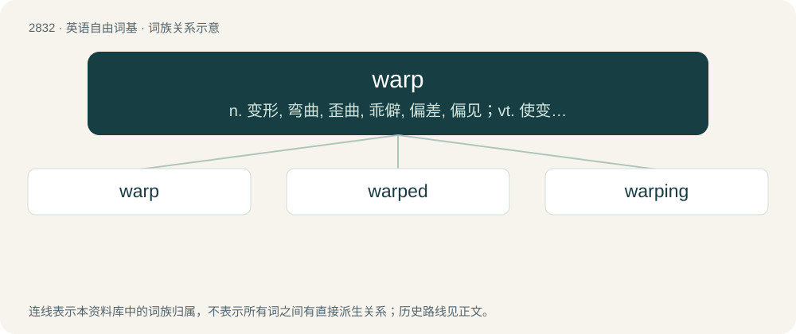

# 2940 · warp — n. 变形, 弯曲, 歪曲, 乖僻, 偏差, 偏见；vt. 使变形, 弄歪, 使翘曲, 使不正常, 歪曲, 使有偏见；vi. 变弯, 变歪

[总目录](../00_总目录_按常用程度.md)

**类型**：英语自由词基　｜　**来源语言**：见词源记录

## 核心含义与来源

- 核心含义：n. 变形, 弯曲, 歪曲, 乖僻, 偏差, 偏见；vt. 使变形, 弄歪, 使翘曲, 使不正常, 歪曲, 使有偏见；vi. 变弯, 变歪
- 英文含义：The state, quality, or condition of being physically bent or twisted out of shape.
- 词形：warp

**多个词源／构词路径**：同一拼写可能有不同来源；以下按词性和含义分别列出。

**来源记录 1**（名词；The state, quality, or condition of being physically bent or twisted out of shape.）

From Middle English warp, werp, from Old English wearp, warp (“a warp, threads stretched lengthwise in a loom, twig, osier”), from Proto-Germanic \*warpą (“a warp”). Cognate with Middle Dutch warp, Middle Low German warp, German werfen, Danish and Swedish varp.

**来源记录 2**（动词；To twist or turn (something) out of shape; to deform.）

From Middle English werpen, weorpen, worpen, from Old English weorpan (“to throw”), from Proto-West Germanic \*werpan, from Proto-Germanic \*werpaną (“to throw, turn”), from Proto-Indo-European \*werb- (“to bend, turn”). Cognate with Scots warp (“to throw, warp”), North Frisian werpen (“to throw”), Dutch werpen (“to throw, cast”), German werfen (“to throw, cast”), Icelandic verpa (“to throw”).

## 词族图

## 单词速览（常用到不常用）

| 单词 | 音标 | 释义 |
|---|---|---|
| [warp](#w-1) | 英 /ˈwɔːp/；美 /ˈwoɹp/ | n. 变形, 弯曲, 歪曲, 乖僻, 偏差, 偏见；vt. 使变形, 弄歪, 使翘曲, 使不正常, 歪曲, 使有偏见；vi. 变弯, 变歪 |
| [warped](#w-2) | 美 /woɹpt/ | a. 反常的; 乖戾的; （变）弯曲的; 变形的；v. 弄弯, 变歪( warp的过去式和过去分词 ); 使（行为等）不合情理, 使乖戾, |
| [warping](#w-3) | /ˈwɔːpiŋ/ | \[化\] 翘曲；\[医\] 传染性流产 |

## 逐词详解

### 1. warp

**词性**：名词　｜　**音标**：英 /ˈwɔːp/；美 /ˈwoɹp/

**中文释义**：n. 变形, 弯曲, 歪曲, 乖僻, 偏差, 偏见；vt. 使变形, 弄歪, 使翘曲, 使不正常, 歪曲, 使有偏见；vi. 变弯, 变歪

**英文义项**：The state, quality, or condition of being physically bent or twisted out of shape. / The state, quality, or condition of being deviant from what is right or proper morally or mentally.

**词源与演化**：

From Middle English warp, werp, from Old English wearp, warp (“a warp, threads stretched lengthwise in a loom, twig, osier”), from Proto-Germanic \*warpą (“a warp”). Cognate with Middle Dutch warp, Middle Low German warp, German werfen, Danish and Swedish varp.

**例句**：

> In weaving, the weft threads run horizontally, interlacing with the vertical warp threads.

### 2. warped

**词性**：形容词　｜　**音标**：美 /woɹpt/

**中文释义**：a. 反常的; 乖戾的; （变）弯曲的; 变形的；v. 弄弯, 变歪( warp的过去式和过去分词 ); 使（行为等）不合情理, 使乖戾,

**英文义项**：Distorted by warping; twisted out of shape / Of a person's mind, attitudes, etc, perverse, strange, aberrant or deviant.

**构词拆分**：From warp + -ed.

**词源与演化**：

From warp + -ed.

**例句**：

> The floors were warped and cracked.

该用例对应义项：used especially of timbers or boards; bent out of shape usually by moisture

### 3. warping

**词性**：名词　｜　**音标**：/ˈwɔːpiŋ/

**中文释义**：\[化\] 翘曲；\[医\] 传染性流产

**英文义项**：An action or motion that warps or twists. / the deformation of the Earth's crust over a large area

**构词拆分**：warp + -ing

**词源与演化**：

From Middle English warpynge; equivalent to warp + -ing.

**例句**：

> Keep the cutting board in a dry, cool place to prevent warping.
