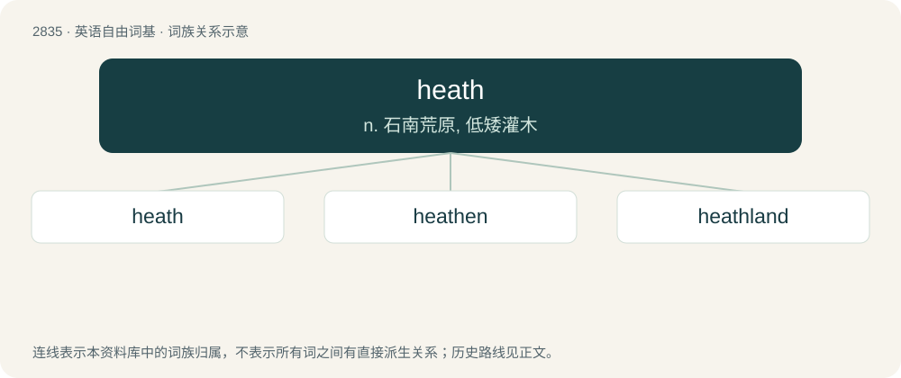

# 2942 · heath — n. 石南荒原, 低矮灌木

[总目录](../00_总目录_按常用程度.md)

**类型**：英语自由词基　｜　**来源语言**：见词源记录

## 核心含义与来源

- 核心含义：n. 石南荒原, 低矮灌木
- 英文含义：A tract of level uncultivated land with sandy soil and scrubby vegetation; heathland.
- 词形：heath

**来源记录 1**（名词；A tract of level uncultivated land with sandy soil and scrubby vegetation; heathland.）

From Middle English heth, heeth, hethe, from Old English hǣþ (“heath, untilled land, waste; heather”), from Proto-West Germanic \*haiþi, from Proto-Germanic \*haiþī (“heath, waste, untilled land”), from Proto-Indo-European \*kayt- (“forest, wasteland, pasture”). Cognate with Dutch heide (“heath, moorland”), German Heide (“heath, moor”), Norwegian hei (“heath”), Swedish hed (“heath, moorland”), Old Welsh coit (“forest”), Welsh coed (“forest”), Latin būcētum (“pastureland”, literally “cow-pasture”) -cetum (“place of, grove of”).

## 词族图

## 单词速览（常用到不常用）

| 单词 | 音标 | 释义 |
|---|---|---|
| [heath](#w-1) | /hiːθ/ | n. 石南荒原, 低矮灌木 |
| [heathen](#w-2) | /ˈhiːðən/ | n. 异教徒, 异族人, 粗野的人；a. 异教的, 野蛮的 |
| [heathland](#w-3) | /ˈhiːθlænd/ | n. &lt;英&gt;欧石南丛生的荒野 |

## 逐词详解

### 1. heath

**词性**：名词　｜　**音标**：/hiːθ/

**中文释义**：n. 石南荒原, 低矮灌木

**英文义项**：A tract of level uncultivated land with sandy soil and scrubby vegetation; heathland. / Any small evergreen shrub of the family Ericaceae.

**词源与演化**：

From Middle English heth, heeth, hethe, from Old English hǣþ (“heath, untilled land, waste; heather”), from Proto-West Germanic \*haiþi, from Proto-Germanic \*haiþī (“heath, waste, untilled land”), from Proto-Indo-European \*kayt- (“forest, wasteland, pasture”). Cognate with Dutch heide (“heath, moorland”), German Heide (“heath, moor”), Norwegian hei (“heath”), Swedish hed (“heath, moorland”), Old Welsh coit (“forest”), Welsh coed (“forest”), Latin būcētum (“pastureland”, literally “cow-pasture”) -cetum (“place of, grove of”).

**例句**：

> Before she could even talk, Ellie Heath used to spend hours drawing.

### 2. heathen

**词性**：形容词　｜　**音标**：/ˈhiːðən/

**中文释义**：n. 异教徒, 异族人, 粗野的人；a. 异教的, 野蛮的

**英文义项**：Not adhering to an Abrahamic religion; pagan. / Uncultured; uncivilized; savage; barbarian.

**构词拆分**：heath (“heathland”) + -en

**词源与演化**：

From Middle English hethen, from Old English hǣþen, from Proto-West Germanic \*haiþin, from Proto-Germanic \*haiþīnaz (“heathen, pagan”, adjective), equivalent to heath (“heathland”) + -en. Cognate with West Frisian heiden, Dutch heiden, Middle High German heiden, German Heiden, German Heide, Swedish heden, Danish hedensk (from heden + -sk), Icelandic heiðinn. See also Proto-Germanic \*haiduz, Old Norse heiðr (honour, bright, moor), Icelandic heiður (honour).

**例句**：

> How so? Do you not want to bet? Are you a heathen?

### 3. heathland

**词性**：名词　｜　**音标**：/ˈhiːθlænd/

**中文释义**：n. &lt;英&gt;欧石南丛生的荒野

**英文义项**：A tract of scrubland habitats characterised by open, low growing woody vegetation, found on mainly infertile acidic soils. Similar to moorland but with warmer and drier climate.

**构词拆分**：heath + land

**词源与演化**：

From heath + land. Compare Saterland Frisian Heedelound (“heathland”).

**例句**：

> Fire devastated an area of rare heathland.
