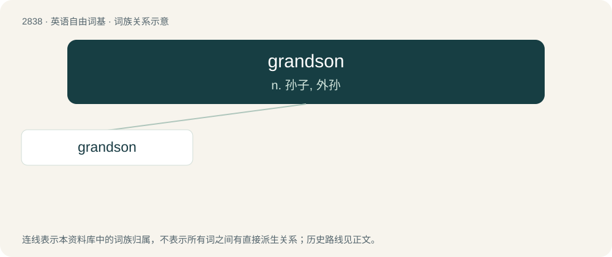

# 2944 · grandson — n. 孙子, 外孙

[总目录](../00_总目录_按常用程度.md)

**类型**：英语自由词基　｜　**来源语言**：见词源记录

## 核心含义与来源

- 核心含义：n. 孙子, 外孙
- 英文含义：A son of one's child.
- 词形：grandson

**来源记录 1**（名词；A son of one's child.）

From grand- + son.

## 词族图

## 单词速览（常用到不常用）

| 单词 | 音标 | 释义 |
|---|---|---|
| [grandson](#w-1) | /ˈɡɹæn(d)sʌn/ | n. 孙子, 外孙 |

## 逐词详解

### 1. grandson

**词性**：名词　｜　**音标**：/ˈɡɹæn(d)sʌn/

**中文释义**：n. 孙子, 外孙

**英文义项**：A son of one's child.

**构词拆分**：grand- + son

**词源与演化**：

From grand- + son.

**例句**：

> When I go to see my grandson, I always give him something.
