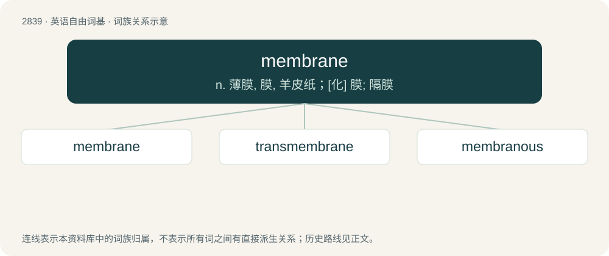

# 2945 · membrane — n. 薄膜, 膜, 羊皮纸；\[化\] 膜; 隔膜

[总目录](../00_总目录_按常用程度.md)

**类型**：英语自由词基　｜　**来源语言**：见词源记录

## 核心含义与来源

- 核心含义：n. 薄膜, 膜, 羊皮纸；\[化\] 膜; 隔膜
- 英文含义：A mechanical, thin, flat flexible part that can deform or vibrate when excited by an external force.
- 词形：membrane

**来源记录 1**（名词；A mechanical, thin, flat flexible part that can deform or vibrate when excited by an external force.）

Late Middle English, borrowed from Latin membrāna (“skin or membrane that covers parts of the body”), from membrum (“a limb or member of the body”) + -āna. Doublet of membrana.

## 词族图

## 单词速览（常用到不常用）

| 单词 | 音标 | 释义 |
|---|---|---|
| [membrane](#w-1) | /ˈmɛm.bɹeɪn/ | n. 薄膜, 膜, 羊皮纸；\[化\] 膜; 隔膜 |
| [transmembrane](#w-2) | /,trænsˈmembrein,,trænz-,,trɑːn-/ | a. \[生\]\[物\]横跨膜的 |
| [membranous](#w-3) | /ˈmɛm.bɹən.əs/ | a. 膜的, 膜性的；\[医\] 膜的 |

## 逐词详解

### 1. membrane

**词性**：名词　｜　**音标**：/ˈmɛm.bɹeɪn/

**中文释义**：n. 薄膜, 膜, 羊皮纸；\[化\] 膜; 隔膜

**英文义项**：A mechanical, thin, flat flexible part that can deform or vibrate when excited by an external force. / A flexible or semiflexible covering or waterproofing whose primary function is to exclude water.

**词源与演化**：

Late Middle English, borrowed from Latin membrāna (“skin or membrane that covers parts of the body”), from membrum (“a limb or member of the body”) + -āna. Doublet of membrana.

**例句**：

> Ribosomes and the plasma membrane are common structures in eukaryotic and prokaryotic cells.

### 2. transmembrane

**词性**：形容词　｜　**音标**：/,trænsˈmembrein,,trænz-,,trɑːn-/

**中文释义**：a. \[生\]\[物\]横跨膜的

**英文义项**：Traversing a cellular membrane. / Of or pertaining to a transmembrane protein or segment.

**构词拆分**：From trans- + membrane.

**词源与演化**：

From trans- + membrane.

### 3. membranous

**词性**：形容词　｜　**音标**：/ˈmɛm.bɹən.əs/

**中文释义**：a. 膜的, 膜性的；\[医\] 膜的

**英文义项**：Having the qualities of, or pertaining to, a membrane. / Accompanying the formation of a usually abnormal membrane or membranous layer.

**构词拆分**：membrane + -ous

**词源与演化**：

From Middle French membraneux; equivalent to membrane + -ous.
