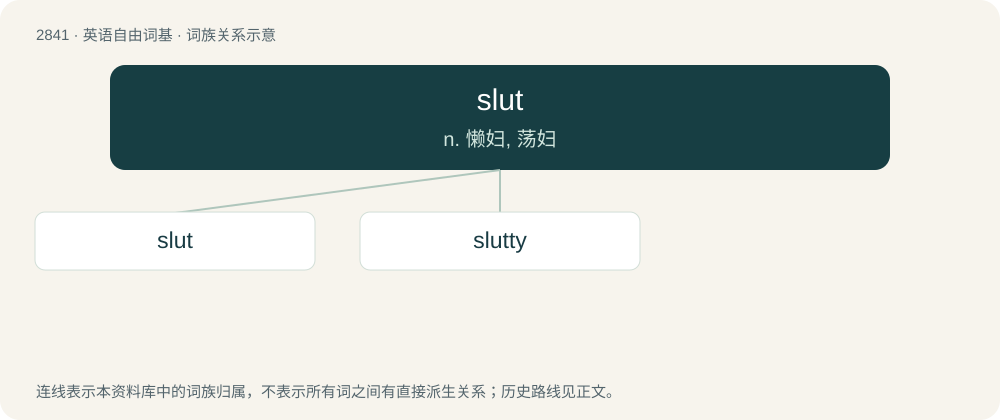

# 2948 · slut — n. 懒妇, 荡妇

[总目录](../00_总目录_按常用程度.md)

**类型**：英语自由词基　｜　**来源语言**：见词源记录

## 核心含义与来源

- 核心含义：n. 懒妇, 荡妇
- 英文含义：A sexually promiscuous woman.
- 词形：slut

**来源记录 1**（名词；A sexually promiscuous woman.）

From Middle English slutt, slutte, slute (“a dirty or slovenly person, usually a woman, scullery maid; messy animal to prepare as food; slush, mud”), probably from Old English \*slȳte (“sleet”), from Proto-West Germanic \*slautijā, from Proto-Germanic \*slautijǭ (“sleet, hail”), related to Proto-West Germanic \*slaut (“puddle, ditch”). Compare Dutch slodder and slet, dialectal Swedish slata (“idle woman”), Norwegian sludd (“sleet”), and the dialectal Norwegian slutr (“sleet, impure liquid”). Doublet of sleet.

## 词族图

## 单词速览（常用到不常用）

| 单词 | 音标 | 释义 |
|---|---|---|
| [slut](#w-1) | /slʌt/ | n. 懒妇, 荡妇 |
| [slutty](#w-2) | /ˈslʌti/ | a. 淫荡的 |

## 逐词详解

### 1. slut

**词性**：名词　｜　**音标**：/slʌt/

**中文释义**：n. 懒妇, 荡妇

**英文义项**：A sexually promiscuous woman. / A prostitute.

**词源与演化**：

From Middle English slutt, slutte, slute (“a dirty or slovenly person, usually a woman, scullery maid; messy animal to prepare as food; slush, mud”), probably from Old English \*slȳte (“sleet”), from Proto-West Germanic \*slautijā, from Proto-Germanic \*slautijǭ (“sleet, hail”), related to Proto-West Germanic \*slaut (“puddle, ditch”). Compare Dutch slodder and slet, dialectal Swedish slata (“idle woman”), Norwegian sludd (“sleet”), and the dialectal Norwegian slutr (“sleet, impure liquid”). Doublet of sleet.

**例句**：

> You could hire a slut for a few hours, if you're that desperate.

该用例对应义项：A prostitute.

### 2. slutty

**词性**：形容词　｜　**音标**：/ˈslʌti/

**中文释义**：a. 淫荡的

**英文义项**：Of, resembling, or suitable for, a slut.

**构词拆分**：slut + -y

**词源与演化**：

From slut + -y.

**例句**：

> The makeup, high heels and short skirt made her look so slutty.

该用例对应义项：Of, resembling, or suitable for, a slut.
