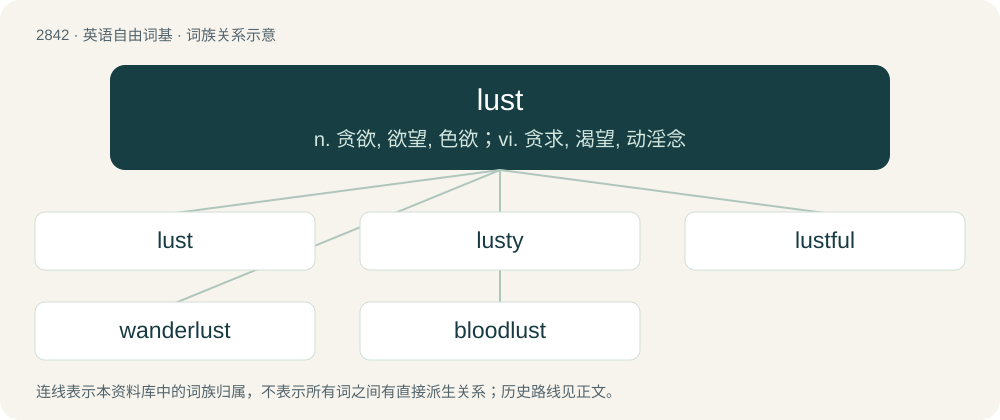

# 2950 · lust — n. 贪欲, 欲望, 色欲；vi. 贪求, 渴望, 动淫念

[总目录](../00_总目录_按常用程度.md)

**类型**：英语自由词基　｜　**来源语言**：见词源记录

## 核心含义与来源

- 核心含义：n. 贪欲, 欲望, 色欲；vi. 贪求, 渴望, 动淫念
- 英文含义：A feeling of strong desire, especially such a feeling driven by sexual arousal.
- 词形：lust

**多个词源／构词路径**：同一拼写可能有不同来源；以下按词性和含义分别列出。

**来源记录 1**（名词；A feeling of strong desire, especially such a feeling driven by sexual arousal.）

From Middle English lust, from Old English lust (“lust, pleasure, longing”), from Proto-West Germanic \*lustu, from Proto-Germanic \*lustuz. Akin to Old Saxon, Dutch lust, Old Frisian, Old High German, German Lust, Swedish lust, Danish lyst, Icelandic lyst, Old Norse losti, Gothic 𐌻𐌿𐍃𐍄𐌿𐍃 (lustus), and perhaps to Sanskrit लष् (laṣ), लषति (laṣati, “to desire”) and Albanian lushë (“bitch, savage dog, promiscuous woman”), or to English loose. Compare list (“to please”), listless.

**来源记录 2**（动词；To look at or watch with a strong desire, especially of a sexual nature.）

From Middle English lusten, from the noun.

## 词族图

## 单词速览（常用到不常用）

| 单词 | 音标 | 释义 |
|---|---|---|
| [lust](#w-1) | 英 /ˈlʌst/；/ˈlɜst/ | n. 贪欲, 欲望, 色欲；vi. 贪求, 渴望, 动淫念 |
| [lusty](#w-2) | /ˈlʌsti/ | a. 健壮的, 精力充沛的 |
| [lustful](#w-3) | /ˈlʌst.fəl/ | a. 贪欲的, 好色的 |
| [wanderlust](#w-4) | 英 /ˈwɒndəlʌst/；美 /ˈwɑndɚˌlʌst/ | n. 漫游癖, 流浪癖 |
| [bloodlust](#w-5) | 英 /ˈblʌdˌlʌst/ | n. 杀戮欲 |

## 逐词详解

### 1. lust

**词性**：名词　｜　**音标**：英 /ˈlʌst/；/ˈlɜst/

**中文释义**：n. 贪欲, 欲望, 色欲；vi. 贪求, 渴望, 动淫念

**英文义项**：A feeling of strong desire, especially such a feeling driven by sexual arousal.

**词源与演化**：

From Middle English lust, from Old English lust (“lust, pleasure, longing”), from Proto-West Germanic \*lustu, from Proto-Germanic \*lustuz. Akin to Old Saxon, Dutch lust, Old Frisian, Old High German, German Lust, Swedish lust, Danish lyst, Icelandic lyst, Old Norse losti, Gothic 𐌻𐌿𐍃𐍄𐌿𐍃 (lustus), and perhaps to Sanskrit लष् (laṣ), लषति (laṣati, “to desire”) and Albanian lushë (“bitch, savage dog, promiscuous woman”), or to English loose. Compare list (“to please”), listless.

**例句**：

> Seeing Leslie fills me with a passionate lust.

该用例对应义项：A feeling of strong desire, especially such a feeling driven by sexual arousal.

### 2. lusty

**词性**：形容词　｜　**音标**：/ˈlʌsti/

**中文释义**：a. 健壮的, 精力充沛的

**英文义项**：Exhibiting lust (in the obsolete sense meaning "vigor"); strong, healthy, robust; vigorous; full of sap or vitality. / Hearty, merry, gleesome, enthusiastic, lively, stirring.

**构词拆分**：lust + -y

**词源与演化**：

From Middle English lusty (“mirthful, pleasant, delicious, delightful”), equivalent to lust + -y. Compare Saterland Frisian lustich (“amusing”), West Frisian lustich (“amusing, funny”), Dutch lustig (“cheerful”), German lustig (“amusing”), Danish lystig (“merry”), Swedish lustig (“funny”).

**例句**：

> Tom gave Mary a lusty look.

### 3. lustful

**词性**：形容词　｜　**音标**：/ˈlʌst.fəl/

**中文释义**：a. 贪欲的, 好色的

**英文义项**：Full of lust; driven by lust.

**构词拆分**：lust + -ful

**词源与演化**：

From Middle English lustful, from Old English lustfull (“desirous, wishful”); equivalent to lust + -ful. Cognate with Dutch lustvol (“lustful, lusty”), German lustvoll (“pleasurable”), Swedish lustfyllt (“pleasurable”), Swedish lustfyllda (“lustful”).

**例句**：

> Her sensuous grace roused his lustful nature.

该用例对应义项：characterized by lust

### 4. wanderlust

**词性**：名词　｜　**音标**：英 /ˈwɒndəlʌst/；美 /ˈwɑndɚˌlʌst/

**中文释义**：n. 漫游癖, 流浪癖

**英文义项**：A strong impulse or longing to travel. / An impulse to be unfaithful or seek out other romantic or sexual partners; a straying heart.

**构词拆分**：wander + lust

**词源与演化**：

Borrowed from German Wanderlust (“an urge to travel; a love of the ‘great outdoors’”), from wandern (“to wander; to hike”) (ultimately from Proto-Indo-European \*wendʰ- (“to turn; to wind”)) + Lust (“a desire, a wish to do or have something; fun, pleasure”) (possibly ultimately from Proto-Indo-European \*lewH- (“to separate; to set free; to untie”)); analysable as wander + lust.

**例句**：

> In spring, Tom is always seized by wanderlust and has to get out into nature.

### 5. bloodlust

**词性**：名词　｜　**音标**：英 /ˈblʌdˌlʌst/

**中文释义**：n. 杀戮欲

**英文义项**：A desire for bloodshed and carnage, often aroused in the heat of battle and leading to uncontrolled slaughter and torture.

**构词拆分**：blood + lust

**词源与演化**：

From blood + lust.

**例句**：

> Berzerkers are famous for the bloodlust, but what about their tender regard for poetry?
