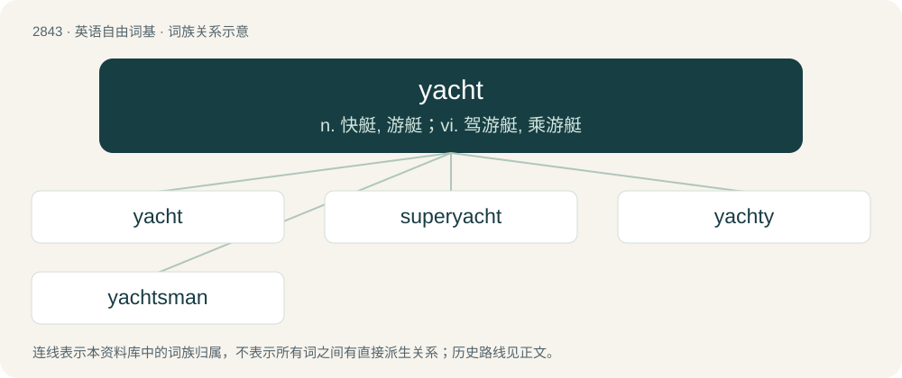

# 2951 · yacht — n. 快艇, 游艇；vi. 驾游艇, 乘游艇

[总目录](../00_总目录_按常用程度.md)

**类型**：英语自由词基　｜　**来源语言**：见词源记录

## 核心含义与来源

- 核心含义：n. 快艇, 游艇；vi. 驾游艇, 乘游艇
- 英文含义：A slick and light ship for making pleasure trips or racing on water, having sails but often motor-powered. At times used as a residence offshore on a dock.
- 词形：yacht

**来源记录 1**（名词；A slick and light ship for making pleasure trips or racing on water, having sails but often motor-powered. At times used as a residence offshore on a dock.）

Circa 1557; variant of yaught, earlier yeaghe (“light, fast-sailing ship”), from Dutch jacht (“yacht; hunt”), in older spelling jaght(e), short for jaghtschip (“light sailing vessel, fast pirate ship”, literally “pursuit ship”), compound of jacht and schip (“ship”). In the 16th century the Dutch built light, fast ships to chase the ships of pirates and smugglers from the coast. The ship was introduced to England in 1660 when the Dutch East India Company presented one to King Charles II, who used it as a pleasure boat, after which it was copied by British shipbuilders as a pleasure craft for wealthy gentlemen.

## 词族图

## 单词速览（常用到不常用）

| 单词 | 音标 | 释义 |
|---|---|---|
| [yacht](#w-1) | 英 /jɒt/；美 /jɑt/ | n. 快艇, 游艇；vi. 驾游艇, 乘游艇 |
| [superyacht](#w-2) |  | 【英文】A very large luxury yacht. |
| [yachty](#w-3) | /ˈjɔti/ | a. 似快艇的, 适合游艇的 |
| [yachtsman](#w-4) | /ˈjɒtsmən/ | n. 游艇驾驶者, 游艇所有者 |

## 逐词详解

### 1. yacht

**词性**：名词　｜　**音标**：英 /jɒt/；美 /jɑt/

**中文释义**：n. 快艇, 游艇；vi. 驾游艇, 乘游艇

**英文义项**：A slick and light ship for making pleasure trips or racing on water, having sails but often motor-powered. At times used as a residence offshore on a dock. / Any vessel used for private, noncommercial purposes.

**词源与演化**：

Circa 1557; variant of yaught, earlier yeaghe (“light, fast-sailing ship”), from Dutch jacht (“yacht; hunt”), in older spelling jaght(e), short for jaghtschip (“light sailing vessel, fast pirate ship”, literally “pursuit ship”), compound of jacht and schip (“ship”). In the 16th century the Dutch built light, fast ships to chase the ships of pirates and smugglers from the coast. The ship was introduced to England in 1660 when the Dutch East India Company presented one to King Charles II, who used it as a pleasure boat, after which it was copied by British shipbuilders as a pleasure craft for wealthy gentlemen.

**例句**：

> You are a true yachtsman! Are you a member of the local yacht club?

该用例对应义项：A slick and light ship for making pleasure trips or racing on water, having sails but often motor-powered. At times used as a residence offshore on a dock.

### 2. superyacht

**词性**：名词

**英文义项**：A very large luxury yacht.

**构词拆分**：super- + yacht

**词源与演化**：

From super- + yacht.

### 3. yachty

**词性**：名词　｜　**音标**：/ˈjɔti/

**中文释义**：a. 似快艇的, 适合游艇的

**英文义项**：A yachtsman or yachtswoman.

**构词拆分**：From yacht + -y (diminutive suffix).

**词源与演化**：

From yacht + -y (diminutive suffix).

### 4. yachtsman

**词性**：名词　｜　**音标**：/ˈjɒtsmən/

**中文释义**：n. 游艇驾驶者, 游艇所有者

**英文义项**：A man who sails a yacht.

**构词拆分**：yacht + -s- + -man

**词源与演化**：

From yacht + -s- + -man.
