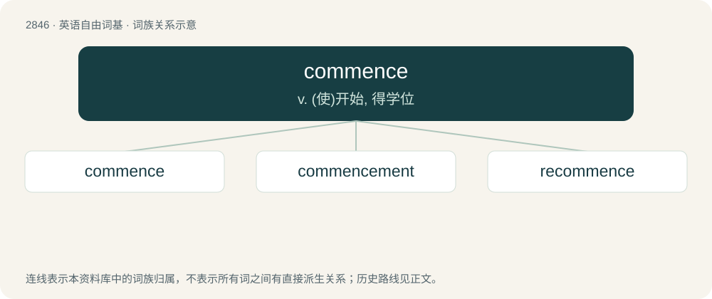

# 2954 · commence — v. (使)开始, 得学位

[总目录](../00_总目录_按常用程度.md)

**类型**：英语自由词基　｜　**来源语言**：见词源记录

## 核心含义与来源

- 核心含义：v. (使)开始, 得学位
- 英文含义：To begin, start.
- 词形：commence

**来源记录 1**（动词；To begin, start.）

From Middle English commencen, comencen (also as contracted comsen, cumsen), from Anglo-Norman comencer, from Vulgar Latin \*cominitiāre, formed from Latin com- + initiō (whence English initiate).

## 词族图

## 单词速览（常用到不常用）

| 单词 | 音标 | 释义 |
|---|---|---|
| [commence](#w-1) | 英 /kəˈmɛns/ | v. (使)开始, 得学位 |
| [commencement](#w-2) | /kəˈmɛnsmənt/ | n. 开始, 毕业典礼；\[法\] 开始, 毕业典礼 |
| [recommence](#w-3) | /.riːkəˈmens/ | v. (使)重新开始 |

## 逐词详解

### 1. commence

**词性**：动词　｜　**音标**：英 /kəˈmɛns/

**中文释义**：v. (使)开始, 得学位

**英文义项**：To begin, start. / To begin, start.

**词源与演化**：

From Middle English commencen, comencen (also as contracted comsen, cumsen), from Anglo-Norman comencer, from Vulgar Latin \*cominitiāre, formed from Latin com- + initiō (whence English initiate).

**例句**：

> At dawn we'll commence to drive.

该用例对应义项：To begin or start.

### 2. commencement

**词性**：名词　｜　**音标**：/kəˈmɛnsmənt/

**中文释义**：n. 开始, 毕业典礼；\[法\] 开始, 毕业典礼

**英文义项**：The first existence of anything; act or fact of commencing; the beginning. / The day when degrees are conferred by colleges and universities upon students and others.

**构词拆分**：commence + -ment

**词源与演化**：

From French commencement; analyzable as commence + -ment.

**例句**：

> The time of Henry VII nearly coincides with the commencement of what is termed modern history.

该用例对应义项：The first existence of anything; act or fact of commencing; the beginning.

### 3. recommence

**词性**：动词　｜　**音标**：/.riːkəˈmens/

**中文释义**：v. (使)重新开始

**英文义项**：To begin again.

**构词拆分**：re- + commence

**词源与演化**：

From Middle French recommencer, from Old French recommencier, equivalent to re- + commence.
