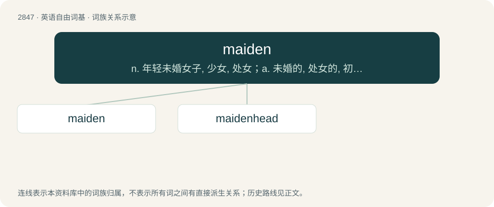

# 2955 · maiden — n. 年轻未婚女子, 少女, 处女；a. 未婚的, 处女的, 初次的, 无经验的

[总目录](../00_总目录_按常用程度.md)

**类型**：英语自由词基　｜　**来源语言**：见词源记录

## 核心含义与来源

- 核心含义：n. 年轻未婚女子, 少女, 处女；a. 未婚的, 处女的, 初次的, 无经验的
- 英文含义：A girl or an unmarried young woman.
- 词形：maiden

**来源记录 1**（名词；A girl or an unmarried young woman.）

From Middle English mayden, meiden, from Old English mæġden (“girl”), originally a diminutive of mæġeþ (“girl”) via diminutive suffix -en, from Proto-West Germanic \*magaþ, from Proto-Germanic \*magaþs. Equivalent to maid + -en.

## 词族图

## 单词速览（常用到不常用）

| 单词 | 音标 | 释义 |
|---|---|---|
| [maiden](#w-1) | 英 /ˈmeɪdən/ | n. 年轻未婚女子, 少女, 处女；a. 未婚的, 处女的, 初次的, 无经验的 |
| [maidenhead](#w-2) | /ˈmeid(ə)nhed/ | n. 处女膜, 处女时期, 处女性；\[医\] 处女膜 |

## 逐词详解

### 1. maiden

**词性**：形容词　｜　**音标**：英 /ˈmeɪdən/

**中文释义**：n. 年轻未婚女子, 少女, 处女；a. 未婚的, 处女的, 初次的, 无经验的

**英文义项**：Virgin. / Without offspring.

**构词拆分**：maid + -en

**词源与演化**：

From Middle English mayden, meiden, from Old English mæġden (“girl”), originally a diminutive of mæġeþ (“girl”) via diminutive suffix -en, from Proto-West Germanic \*magaþ, from Proto-Germanic \*magaþs. Equivalent to maid + -en.

**例句**：

> He bowled a record twelve maiden overs in his spell of 8-33 in 21 overs.

该用例对应义项：Being an over in which no runs are scored.

### 2. maidenhead

**词性**：名词　｜　**音标**：/ˈmeid(ə)nhed/

**中文释义**：n. 处女膜, 处女时期, 处女性；\[医\] 处女膜

**英文义项**：The hymen. / Virginity.

**构词拆分**：maiden + -head

**词源与演化**：

From maiden + -head.
