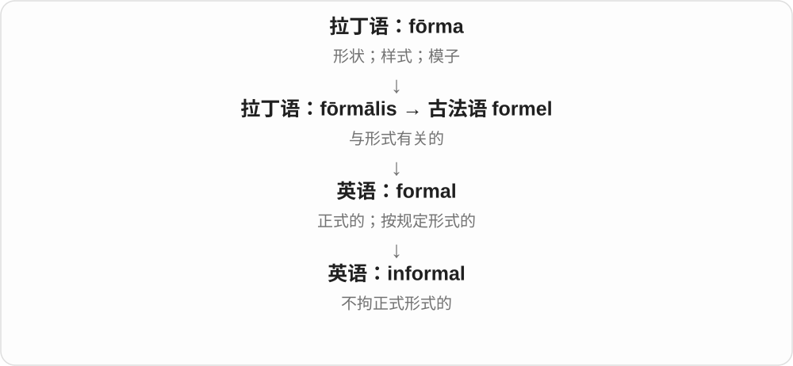

# 2957 · informal — 正式形式的否定，再分方式与气氛性质

[逐词精讲目录](../00_逐词精讲目录.md) · [总目录](../00_总目录_按常用程度.md)

## 核心词根与来源

衣着、会议、语言、相处气氛都可以有正式程度差别。非正式常让沟通更随意，不等于不准确、保密或毫无规则。

**INFORMAL：不必摆正式架势，事情仍可认真谈**

informal → informally、informality，性质、方式、性质名词按顺序理解。

- **性质、方式与气氛**：informal · informally · informality

## 词形与演化规律

in- 否定 + formal → informal；-ly 方式；-ity 性质并带重音变化。

## 单词速览（按词族由简到繁）

同一基础词的相关扩展放在一起，先读基础形式，再读扩展；各组之间优先读常用的。具体词源关系见各词讲解。

| 单词 | 音标 | 核心意思 |
|---|---|---|
| [informal](#w-1) | 英 /ɪnˈfɔːməl/；美 /ɪnˈfɔːrməl/ | 非正式的；随意的 |
| [informally](#w-2) | 英 /ɪnˈfɔːməli/；美 /ɪnˈfɔːrməli/ | 非正式地；随意地、不拘礼节地 |
| [informality](#w-3) | 英 /ˌɪnfɔːˈmæləti/；美 /ˌɪnfɔːrˈmæləti/ | 非正式；随意、不拘礼节的气氛 |

## 逐词讲解

### 1. informal — 非正式的；随意的

**音标**：英 /ɪnˈfɔːməl/；美 /ɪnˈfɔːrməl/

**先抓住这个画面**

把严格的仪式和固定程序放松一点，人可以像平常聊天一样交流。

**怎么拆**

in- 表否定，接 formal；这里的 in- 不是 inform 中“赋予形状”的 in-。

**怎么变成今天的意思**

可以形容聊天、聚会、衣着或约定。非正式并不等于粗鲁，也不保证一件约定没有实际影响。

**常见搭配与例句**

an informal chat；informal clothes；an informal arrangement。

> We had an informal chat over coffee.

我们喝着咖啡随便聊了聊。

> The office has an informal dress code.

办公室对着装要求比较随意。

**别混淆**

informal 是场合或表达不正式；unprofessional 是不专业，两者不能画等号。

### 2. informally — 非正式地；随意地、不拘礼节地

**音标**：英 /ɪnˈfɔːməli/；美 /ɪnˈfɔːrməli/

**先抓住这个画面**

会议还没正式开始，几个人端着杯子先聊聊，是 talk informally；不穿礼服、不按隆重程序，也能是 informally。它说形式轻松，不保证内容不重要。

**怎么拆**

informal + -ly → informally。informal 由否定 in- + formal 形成，-ly 再把性质变成方式副词。

**怎么变成今天的意思**

**in- 否定 + formal → informal**  
不按正式形式、礼仪或安排

↓

**informal + -ly、-ity**  
非正式地；随意、非正式的性质和气氛

meet informally 非正式碰面；dress informally 穿着随意；speak informally 随意交谈。

**常见搭配与例句**

meet informally；dress informally。

> We met informally before the main discussion.

正式讨论前，我们先非正式地见了面。

> Guests were invited to dress informally.

客人们被告知可以穿得随意一些。

**别混淆**

informally 不等于 inaccurately 不准确，也不等于 secretly 秘密地；正式程度与准确性、保密性是不同方面。

### 3. informality — 非正式；随意、不拘礼节的气氛

**音标**：英 /ˌɪnfɔːˈmæləti/；美 /ˌɪnfɔːrˈmæləti/

**先抓住这个画面**

大家直呼名字，座位不分高低，聊天不用先走复杂程序，这种不拘礼节的整体感觉是 informality。

**怎么拆**

informal + -ity → informality，重音转到后部 /mæ/。-ity 把不拘形式的性质作为名词，也可在特定语境指非正式表达。

**怎么变成今天的意思**

**in- 否定 + formal → informal**  
不按正式形式、礼仪或安排

↓

**informal + -ly、-ity**  
非正式地；随意、非正式的性质和气氛

the informality of the meeting 会议的随意气氛；a sense of informality 不拘礼节的感觉。

**常见搭配与例句**

the informality of；a sense of informality。

> She liked the informality of the small office.

她喜欢小办公室不拘礼节的气氛。

> The room’s layout encouraged a sense of informality.

房间布局营造了轻松随意的感觉。

**别混淆**

informality 可以让人放松，也可能不合某场合要求，褒贬取决于场景；它不等于没有规则。

## 这一组要分清什么

informally 看怎样进行，informality 看整体性质、气氛；准确性另谈。

## 串起来练习

They spoke informally, and the informality helped everyone relax.

他们随意交谈，轻松的气氛让大家放松下来。
