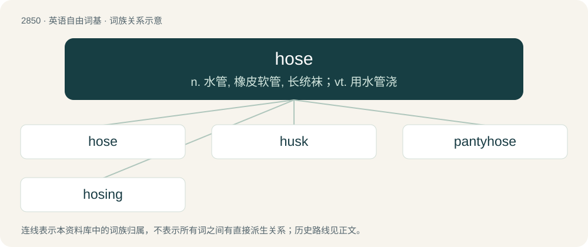

# 2959 · hose — n. 水管, 橡皮软管, 长统袜；vt. 用水管浇

[总目录](../00_总目录_按常用程度.md)

**类型**：英语自由词基　｜　**来源语言**：见词源记录

## 核心含义与来源

- 核心含义：n. 水管, 橡皮软管, 长统袜；vt. 用水管浇
- 英文含义：A flexible tube conveying water or other fluid.
- 词形：hose

**来源记录 1**（名词；A flexible tube conveying water or other fluid.）

From Middle English hose (“leggings, hose”), from Old English hose, hosa (“hose, leggings”), from Proto-West Germanic \*hosā, from Proto-Germanic \*husǭ (“coverings, leggings, trousers”), from Proto-Indo-European \*(s)kewH- (“to cover”). Cognate with West Frisian hoas (“hose”), Dutch hoos (“stocking, water-hose”), German Hose (“trousers”); also, Tocharian A kać (“skin”), Russian кишка́ (kišká, “gut”), Ancient Greek κύστις (kústis, “bladder”), Sanskrit कोष्ठ (koṣṭha, “intestine”). More at sky. The clothing senses were the original meaning, from which is derived the sense of a tube for fluids.

## 词族图

## 单词速览（常用到不常用）

| 单词 | 音标 | 释义 |
|---|---|---|
| [hose](#w-1) | 英 /həʊz/；美 /hoʊz/ | n. 水管, 橡皮软管, 长统袜；vt. 用水管浇 |
| [husk](#w-2) | 英 /hʌsk/ | n. 外壳, 皮, 无价值之物；vt. 剥...的壳, 削皮 |
| [pantyhose](#w-3) | /ˈpæntɪhəuz/ | n. 连裤袜 |
| [hosing](#w-4) | 英 /ˈhəʊzɪŋ/；美 /ˈhoʊzɪŋ/ | vt. 用软管浇（hose的现在分词形式） |

## 逐词详解

### 1. hose

**词性**：名词　｜　**音标**：英 /həʊz/；美 /hoʊz/

**中文释义**：n. 水管, 橡皮软管, 长统袜；vt. 用水管浇

**英文义项**：A flexible tube conveying water or other fluid. / A stocking-like garment worn on the legs; pantyhose, women's tights.

**词源与演化**：

From Middle English hose (“leggings, hose”), from Old English hose, hosa (“hose, leggings”), from Proto-West Germanic \*hosā, from Proto-Germanic \*husǭ (“coverings, leggings, trousers”), from Proto-Indo-European \*(s)kewH- (“to cover”). Cognate with West Frisian hoas (“hose”), Dutch hoos (“stocking, water-hose”), German Hose (“trousers”); also, Tocharian A kać (“skin”), Russian кишка́ (kišká, “gut”), Ancient Greek κύστις (kústis, “bladder”), Sanskrit कोष्ठ (koṣṭha, “intestine”). More at sky. The clothing senses were the original meaning, from which is derived the sense of a tube for fluids.

**例句**：

> The water stopped running because the hose has a kink in it.

### 2. husk

**词性**：名词　｜　**音标**：英 /hʌsk/

**中文释义**：n. 外壳, 皮, 无价值之物；vt. 剥...的壳, 削皮

**英文义项**：The dry, leafy or stringy exterior of certain vegetables or fruits, which must be removed before eating the meat inside. / Any form of useless, dried up, and subsequently worthless exterior of something.

**构词拆分**：hose + -ock

**词源与演化**：

From Middle English huske, husk (“husk”). Perhaps from Old English \*husuc, \*hosuc (“little covering, sheath”), diminutive of hosu (“pod, shell, husk”), from Proto-West Germanic \*hosā, from Proto-Germanic \*husǭ (“covering, shell, leggings”), from Proto-Indo-European \*kawəs- / kawes- (“cover”). If so, equivalent to hose + -ock. Alternatively from Middle Low German hûs(e)ken, hü̂seken (“little house, sheath”), Middle Dutch husekijn (“little house, core of fruit, case”), diminutive of hûs (“house”). Compare Dutch huisje, German Häuschen, both also used for “snailshell”.

**例句**：

> His attorney was a dried-up husk of a man.

该用例对应义项：Any form of useless, dried up, and subsequently worthless exterior of something.

### 3. pantyhose

**词性**：名词　｜　**音标**：/ˈpæntɪhəuz/

**中文释义**：n. 连裤袜

**英文义项**：Thin nylon tights worn over the legs, usually tan in color.

**构词拆分**：panty + hose

**词源与演化**：

From panty + hose.

**例句**：

> Mary caught Tom trying her pantyhose on in the bathroom.

### 4. hosing

**词性**：名词　｜　**音标**：英 /ˈhəʊzɪŋ/；美 /ˈhoʊzɪŋ/

**中文释义**：vt. 用软管浇（hose的现在分词形式）

**英文义项**：A spraying or washing with a hose.

**构词拆分**：hose + -ing

**词源与演化**：

From hose + -ing (gerund ending).
