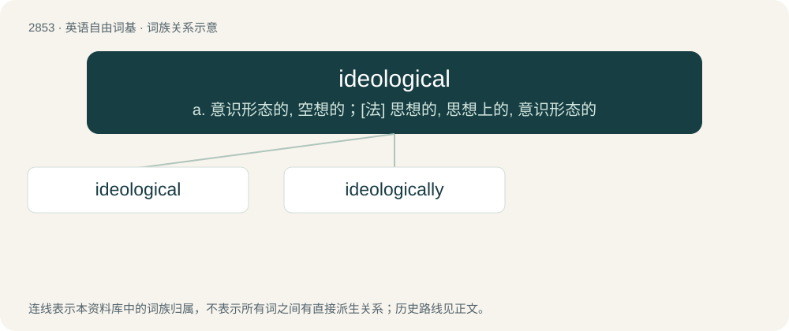

# 2962 · ideological — a. 意识形态的, 空想的；\[法\] 思想的, 思想上的, 意识形态的

[总目录](../00_总目录_按常用程度.md)

**类型**：英语自由词基　｜　**来源语言**：见词源记录

## 核心含义与来源

- 核心含义：a. 意识形态的, 空想的；\[法\] 思想的, 思想上的, 意识形态的
- 英文含义：Of or pertaining to one or more ideologies.
- 词形：ideological

**来源记录 1**（形容词；Of or pertaining to one or more ideologies.）

From ideology + -ical.

## 词族图

## 单词速览（常用到不常用）

| 单词 | 音标 | 释义 |
|---|---|---|
| [ideological](#w-1) | 英 /ˌaɪ.diː.əˈlɒd͡ʒ.ɪ.kəl/；美 /ˌaɪ.di.əˈlɑ.d͡ʒɪ.kəl/ | a. 意识形态的, 空想的；\[法\] 思想的, 思想上的, 意识形态的 |
| [ideologically](#w-2) |  | adv. 思想上, 思想体系, 意识形态, 观念形态 |

## 逐词详解

### 1. ideological

**词性**：形容词　｜　**音标**：英 /ˌaɪ.diː.əˈlɒd͡ʒ.ɪ.kəl/；美 /ˌaɪ.di.əˈlɑ.d͡ʒɪ.kəl/

**中文释义**：a. 意识形态的, 空想的；\[法\] 思想的, 思想上的, 意识形态的

**英文义项**：Of or pertaining to one or more ideologies. / Irrational; supported by misinformation and social reinforcement, as opposed to credible evidence.

**构词拆分**：ideology + -ical

**词源与演化**：

From ideology + -ical.

**例句**：

> The regime, ideological in governance, continued its agenda despite experts’ criticism.

该用例对应义项：Characterized by strict, uncompromising adherence to a particular political ideology, rather than what’s necessarily considered popular or practical.

### 2. ideologically

**词性**：副词

**中文释义**：adv. 思想上, 思想体系, 意识形态, 观念形态

**英文义项**：In an ideological manner; with respect to ideology.

**构词拆分**：ideological + -ly

**词源与演化**：

From ideological + -ly.

**例句**：

> Ideologically, we do not see eye to eye.

该用例对应义项：with respect to ideology
