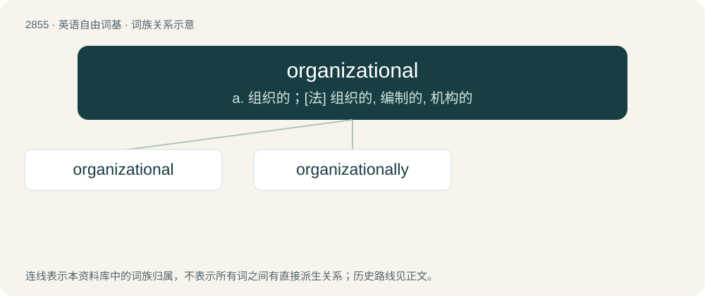

# 2963 · organizational — a. 组织的；\[法\] 组织的, 编制的, 机构的

[总目录](../00_总目录_按常用程度.md)

**类型**：英语自由词基　｜　**来源语言**：见词源记录

## 核心含义与来源

- 核心含义：a. 组织的；\[法\] 组织的, 编制的, 机构的
- 英文含义：Of, relating to, or produced by an organization.
- 词形：organizational

**来源记录 1**（形容词；Of, relating to, or produced by an organization.）

From organization + -al.

## 词族图

## 单词速览（常用到不常用）

| 单词 | 音标 | 释义 |
|---|---|---|
| [organizational](#w-1) | /ˌɔː(ɹ)ɡənɪˈzeɪʃənəl/ | a. 组织的；\[法\] 组织的, 编制的, 机构的 |
| [organizationally](#w-2) |  | adv. organizational的变形 |

## 逐词详解

### 1. organizational

**词性**：形容词　｜　**音标**：/ˌɔː(ɹ)ɡənɪˈzeɪʃənəl/

**中文释义**：a. 组织的；\[法\] 组织的, 编制的, 机构的

**英文义项**：Of, relating to, or produced by an organization. / Relating to the action of organizing something.

**构词拆分**：From organization + -al.

**词源与演化**：

From organization + -al.

**例句**：

> They changed the company's organizational structure.

该用例对应义项：Of, relating to, or produced by an organization.

### 2. organizationally

**词性**：副词

**中文释义**：adv. organizational的变形

**英文义项**：In an organizational manner. / With regard to organization or an organization.

**构词拆分**：organizational + -ly

**词源与演化**：

From organizational + -ly.

**例句**：

> Organizationally, the conference was a disaster!

该用例对应义项：with regard to organization
