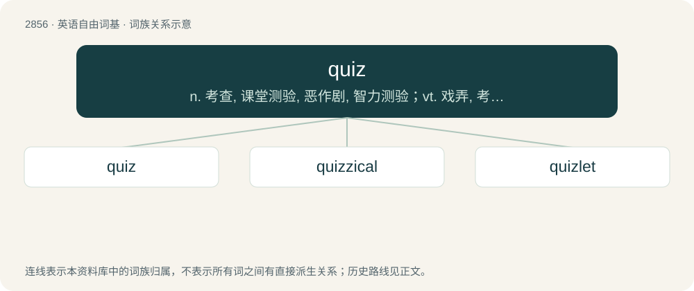

# 2964 · quiz — n. 考查, 课堂测验, 恶作剧, 智力测验；vt. 戏弄, 考查, 恶作剧

[总目录](../00_总目录_按常用程度.md)

**类型**：英语自由词基　｜　**来源语言**：见词源记录

## 核心含义与来源

- 核心含义：n. 考查, 课堂测验, 恶作剧, 智力测验；vt. 戏弄, 考查, 恶作剧
- 英文含义：An odd, puzzling or absurd person or thing.
- 词形：quiz

**来源记录 1**（名词；An odd, puzzling or absurd person or thing.）

Attested since the 1780s, of unknown origin. \* The Century Dictionary suggests it was originally applied to a popular toy, from a dialectal variant of whiz. \* The Random House Dictionary suggests the original sense was "odd person" (circa 1780). \* Others suggest the meaning "hoax" was original (1796), shifting to the meaning "interrogate" (1847) under the influence of question and inquisitive. \* Some say without evidence it was invented by a late-18th-century Dublin theatre proprietor who bet he could add a new nonsense word to the English language; he had the word painted on walls all over the city, and the morning after, everyone was talking about it (The Pre-Victorian Drama in Dublin). \* Others suggest it was originally quies (1847), Latin qui es? (who are you?), traditionally the first question in oral Latin exams. They suggest that it was first used as a noun from 1867, and the spelling quiz first recorded in 1886, but this is demonstrably incorrect. \* A further derivation, assuming that the original sense is "good, ingenuous, harmless man, overly conventional, pedantic, rule-bound man, square; nerd; oddball, eccentric", is based on a column from 1785 which claims that the origin is a jocular translation of the Horace quotation vir bonus est quis as "the good man is a quiz" at Cambridge.

## 词族图

## 单词速览（常用到不常用）

| 单词 | 音标 | 释义 |
|---|---|---|
| [quiz](#w-1) | /kwɪz/ | n. 考查, 课堂测验, 恶作剧, 智力测验；vt. 戏弄, 考查, 恶作剧 |
| [quizzical](#w-2) | /ˈkwɪzɪkəl/ | a. 戏弄的, 探询的, 古怪的 |
| [quizlet](#w-3) | /ˈkwɪz.lət/ | 【英文】A short quiz. |

## 逐词详解

### 1. quiz

**词性**：名词　｜　**音标**：/kwɪz/

**中文释义**：n. 考查, 课堂测验, 恶作剧, 智力测验；vt. 戏弄, 考查, 恶作剧

**英文义项**：An odd, puzzling or absurd person or thing. / One who questions or interrogates; a prying person.

**词源与演化**：

Attested since the 1780s, of unknown origin. \* The Century Dictionary suggests it was originally applied to a popular toy, from a dialectal variant of whiz. \* The Random House Dictionary suggests the original sense was "odd person" (circa 1780). \* Others suggest the meaning "hoax" was original (1796), shifting to the meaning "interrogate" (1847) under the influence of question and inquisitive. \* Some say without evidence it was invented by a late-18th-century Dublin theatre proprietor who bet he could add a new nonsense word to the English language; he had the word painted on walls all over the city, and the morning after, everyone was talking about it (The Pre-Victorian Drama in Dublin). \* Others suggest it was originally quies (1847), Latin qui es? (who are you?), traditionally the first question in oral Latin exams. They suggest that it was first used as a noun from 1867, and the spelling quiz first recorded in 1886, but this is demonstrably incorrect. \* A further derivation, assuming that the original sense is "good, ingenuous, harmless man, overly conventional, pedantic, rule-bound man, square; nerd; oddball, eccentric", is based on a column from 1785 which claims that the origin is a jocular translation of the Horace quotation vir bonus est quis as "the good man is a quiz" at Cambridge.

**例句**：

> We came second in the pub quiz.

该用例对应义项：A competition in the answering of questions.

### 2. quizzical

**词性**：形容词　｜　**音标**：/ˈkwɪzɪkəl/

**中文释义**：a. 戏弄的, 探询的, 古怪的

**英文义项**：Questioning or suggesting puzzlement. / Strange or eccentric.

**构词拆分**：quiz + -ical

**词源与演化**：

From quiz + -ical.

**例句**：

> His expression was half derisory, half quizzical.

### 3. quizlet

**词性**：名词　｜　**音标**：/ˈkwɪz.lət/

**英文义项**：A short quiz.

**构词拆分**：quiz + -let

**词源与演化**：

From quiz + -let.
