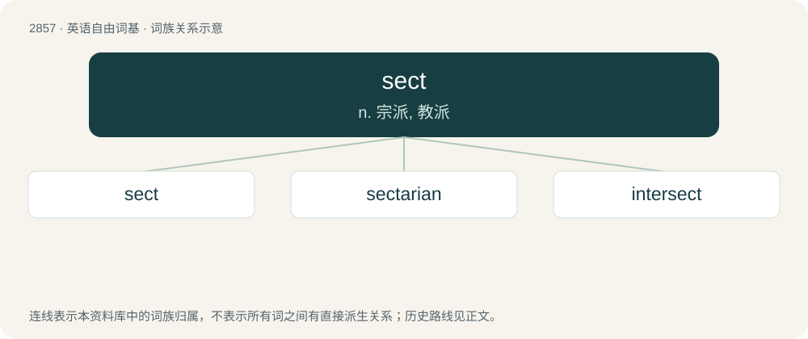

# 2965 · sect — n. 宗派, 教派

[总目录](../00_总目录_按常用程度.md)

**类型**：英语自由词基　｜　**来源语言**：见词源记录

## 核心含义与来源

- 核心含义：n. 宗派, 教派
- 英文含义：An offshoot of a larger religion or denomination.
- 词形：sect

**来源记录 1**（名词；An offshoot of a larger religion or denomination.）

From Middle English secte, from Old French secte (“a sect in philosophy or religion”), from Late Latin secta (“a sect in philosophy or religion, a school, party, faction, class, guild, band, particularly a heretical doctrine or sect, etc.”), possibly, from Latin sequi (“to follow”). Alternatively linked to sectus (“cut off, divided”), past participle of secō.

## 词族图

## 单词速览（常用到不常用）

| 单词 | 音标 | 释义 |
|---|---|---|
| [sect](#w-1) | /sɛkt/ | n. 宗派, 教派 |
| [sectarian](#w-2) | 英 /sɛkˈtɛəɹi.ən/；美 /sɛkˈtɛɹi.ən/ | a. 宗派的, 党派的, 偏狭的；n. 宗派成员, 闹宗派的人 |
| [intersect](#w-3) | /.intəˈsekt/ | 【英文】Between sects; intersectarian. |

## 逐词详解

### 1. sect

**词性**：名词　｜　**音标**：/sɛkt/

**中文释义**：n. 宗派, 教派

**英文义项**：An offshoot of a larger religion or denomination. / A group following a specific ideal or a leader.

**词源与演化**：

From Middle English secte, from Old French secte (“a sect in philosophy or religion”), from Late Latin secta (“a sect in philosophy or religion, a school, party, faction, class, guild, band, particularly a heretical doctrine or sect, etc.”), possibly, from Latin sequi (“to follow”). Alternatively linked to sectus (“cut off, divided”), past participle of secō.

**用法示例／搭配（非完整句）**：

> a religious sect

该用例对应义项：An offshoot of a larger religion or denomination.

### 2. sectarian

**词性**：形容词　｜　**音标**：英 /sɛkˈtɛəɹi.ən/；美 /sɛkˈtɛɹi.ən/

**中文释义**：a. 宗派的, 党派的, 偏狭的；n. 宗派成员, 闹宗派的人

**英文义项**：Of, relating to, or partial to a sect. / Dogmatic or partisan.

**构词拆分**：Medieval Latin sectarius + -an；sect + -arian

**词源与演化**：

From Medieval Latin sectarius + -an. Its corresponding etymology per the first sense is sect + -arian.

**例句**：

> We were discussing solutions to the sectarian violence between Sunnis and Shias.

该用例对应义项：Of, relating to, or partial to a sect.

### 3. intersect

**词性**：形容词　｜　**音标**：/.intəˈsekt/

**英文义项**：Between sects; intersectarian.

**构词拆分**：inter- + sect

**词源与演化**：

From inter- + sect.
