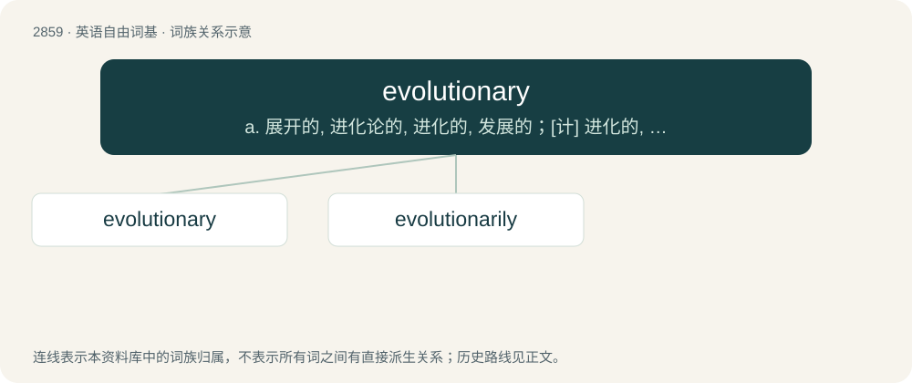

# 2967 · evolutionary — a. 展开的, 进化论的, 进化的, 发展的；\[计\] 进化的, 改良的, 发展的

[总目录](../00_总目录_按常用程度.md)

**类型**：英语自由词基　｜　**来源语言**：见词源记录

## 核心含义与来源

- 核心含义：a. 展开的, 进化论的, 进化的, 发展的；\[计\] 进化的, 改良的, 发展的
- 英文含义：Of or relating to the biological theory of evolution.
- 词形：evolutionary

**来源记录 1**（形容词；Of or relating to the biological theory of evolution.）

From evolution + -ary.

## 词族图

## 单词速览（常用到不常用）

| 单词 | 音标 | 释义 |
|---|---|---|
| [evolutionary](#w-1) | 英 /ˌiː.vəˈl(j)uː.ʃən.ɹi/；美 /ˌiː.vəˈluː.ʃən.ɛɹ.i/ | a. 展开的, 进化论的, 进化的, 发展的；\[计\] 进化的, 改良的, 发展的 |
| [evolutionarily](#w-2) | /,iːvə,luːʃənˈærili/ | adv. 演化地, 演进地(evolutionary的变形) |

## 逐词详解

### 1. evolutionary

**词性**：形容词　｜　**音标**：英 /ˌiː.vəˈl(j)uː.ʃən.ɹi/；美 /ˌiː.vəˈluː.ʃən.ɛɹ.i/

**中文释义**：a. 展开的, 进化论的, 进化的, 发展的；\[计\] 进化的, 改良的, 发展的

**英文义项**：Of or relating to the biological theory of evolution. / Having formal similarities to the biological theory of evolution.

**构词拆分**：evolution + -ary

**词源与演化**：

From evolution + -ary.

**例句**：

> The evolutionary history of marine mammals includes land-dwelling ancestors.

该用例对应义项：Of or relating to the biological theory of evolution.

### 2. evolutionarily

**词性**：副词　｜　**音标**：/,iːvə,luːʃənˈærili/

**中文释义**：adv. 演化地, 演进地(evolutionary的变形)

**英文义项**：In a manner relating to evolution or slow development. / From the perspective of evolution.

**构词拆分**：evolutionary + -ly

**词源与演化**：

From evolutionary + -ly.

**例句**：

> The mutation has been evolutionarily successful.

该用例对应义项：in an evolutionary way; from an evolutionary point of view
