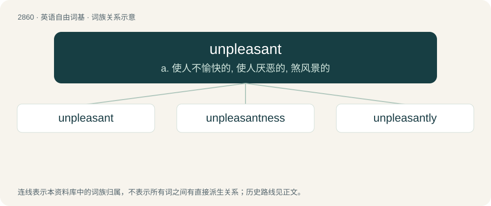

# 2969 · unpleasant — a. 使人不愉快的, 使人厌恶的, 煞风景的

[总目录](../00_总目录_按常用程度.md)

**类型**：英语自由词基　｜　**来源语言**：见词源记录

## 核心含义与来源

- 核心含义：a. 使人不愉快的, 使人厌恶的, 煞风景的
- 英文含义：Not pleasant.
- 词形：unpleasant

**来源记录 1**（形容词；Not pleasant.）

From Middle English unplesaunt, equivalent to un- + pleasant.

## 词族图

## 单词速览（常用到不常用）

| 单词 | 音标 | 释义 |
|---|---|---|
| [unpleasant](#w-1) | /ʌnˈplɛzn̩t/ | a. 使人不愉快的, 使人厌恶的, 煞风景的 |
| [unpleasantness](#w-2) | /ʌnˈplɛz.ənt.nəs/ | n. 不愉快, 煞风景, 不愉快事件, 争执 |
| [unpleasantly](#w-3) | /ʌnˈplezntli/ | adv. 令人不愉快地, 不讨人喜欢地 |

## 逐词详解

### 1. unpleasant

**词性**：形容词　｜　**音标**：/ʌnˈplɛzn̩t/

**中文释义**：a. 使人不愉快的, 使人厌恶的, 煞风景的

**英文义项**：Not pleasant.

**构词拆分**：un- + pleasant

**词源与演化**：

From Middle English unplesaunt, equivalent to un- + pleasant.

**例句**：

> Wet blankets are not always unpleasant after you get to know them.

### 2. unpleasantness

**词性**：名词　｜　**音标**：/ʌnˈplɛz.ənt.nəs/

**中文释义**：n. 不愉快, 煞风景, 不愉快事件, 争执

**英文义项**：The property of being unpleasant or disagreeable. / An unpleasant behaviour, occurrence, etc.

**构词拆分**：unpleasant + -ness

**词源与演化**：

From unpleasant + -ness.

### 3. unpleasantly

**词性**：副词　｜　**音标**：/ʌnˈplezntli/

**中文释义**：adv. 令人不愉快地, 不讨人喜欢地

**英文义项**：In an unpleasant manner.

**构词拆分**：unpleasant + -ly

**词源与演化**：

From unpleasant + -ly.

**例句**：

> He had been unpleasantly surprised.

该用例对应义项：in an unpleasant manner
