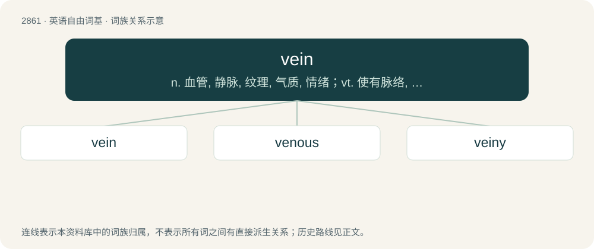

# 2970 · vein — n. 血管, 静脉, 纹理, 气质, 情绪；vt. 使有脉络, 像脉络般分布于

[总目录](../00_总目录_按常用程度.md)

**类型**：英语自由词基　｜　**来源语言**：见词源记录

## 核心含义与来源

- 核心含义：n. 血管, 静脉, 纹理, 气质, 情绪；vt. 使有脉络, 像脉络般分布于
- 英文含义：A blood vessel that transports blood from the capillaries back to the heart.
- 词形：vein

**来源记录 1**（名词；A blood vessel that transports blood from the capillaries back to the heart.）

From Middle English veine, borrowed from Anglo-Norman veine, from Latin vēna (“a blood-vessel; vein; artery”) of uncertain origin. See vēna for more. Doublet of vena. Displaced native edre, from ǣdre (whence edder).

## 词族图

## 单词速览（常用到不常用）

| 单词 | 音标 | 释义 |
|---|---|---|
| [vein](#w-1) | 英 /veɪn/ | n. 血管, 静脉, 纹理, 气质, 情绪；vt. 使有脉络, 像脉络般分布于 |
| [venous](#w-2) | /ˈviː.nəs/ | a. 静脉的, 在静脉中的, 有脉的；\[医\] 静脉的 |
| [veiny](#w-3) | /ˈveɪni/ | a. 多静脉的, 有静脉的, 多脉纹的 |

## 逐词详解

### 1. vein

**词性**：名词　｜　**音标**：英 /veɪn/

**中文释义**：n. 血管, 静脉, 纹理, 气质, 情绪；vt. 使有脉络, 像脉络般分布于

**英文义项**：A blood vessel that transports blood from the capillaries back to the heart. / The entrails of a shrimp.

**词源与演化**：

From Middle English veine, borrowed from Anglo-Norman veine, from Latin vēna (“a blood-vessel; vein; artery”) of uncertain origin. See vēna for more. Doublet of vena. Displaced native edre, from ǣdre (whence edder).

**例句**：

> The nurse hovered her vein finder to locate the veins in the patient's body.

该用例对应义项：A blood vessel that transports blood from the capillaries back to the heart.

### 2. venous

**词性**：形容词　｜　**音标**：/ˈviː.nəs/

**中文释义**：a. 静脉的, 在静脉中的, 有脉的；\[医\] 静脉的

**英文义项**：Of or pertaining to veins. / Having passed through the capillaries and given up oxygen for the tissues and become charged with carbon dioxide.

**构词拆分**：vein + -ous

**词源与演化**：

Morphologically vein + -ous, which is a borrowing from Latin vēnōsus (“full of veins, veiny”), from vēna (“a blood vessel, vein”) + -ōsus (“-ous, -ose”, adjectival suffix). Doublet of venose.

**例句**：

> Her venous circulation was poor, leading to varicose veins.

该用例对应义项：Of or pertaining to veins.

### 3. veiny

**词性**：形容词　｜　**音标**：/ˈveɪni/

**中文释义**：a. 多静脉的, 有静脉的, 多脉纹的

**英文义项**：Having prominent veins.

**构词拆分**：vein + -y

**词源与演化**：

From vein + -y.
