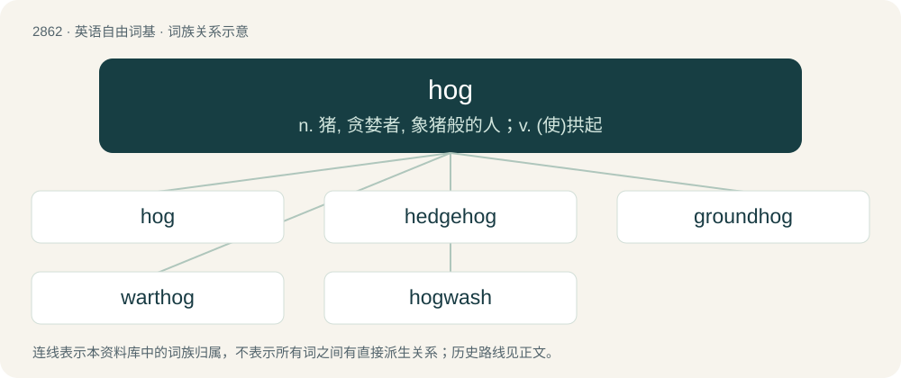

# 2971 · hog — n. 猪, 贪婪者, 象猪般的人；v. (使)拱起

[总目录](../00_总目录_按常用程度.md)

**类型**：英语自由词基　｜　**来源语言**：见词源记录

## 核心含义与来源

- 核心含义：n. 猪, 贪婪者, 象猪般的人；v. (使)拱起
- 英文含义：Any animal belonging to the Suidae family of mammals, especially the pig, the warthog, and the boar.
- 词形：hog

**多个词源／构词路径**：同一拼写可能有不同来源；以下按词性和含义分别列出。

**来源记录 1**（名词；Any animal belonging to the Suidae family of mammals, especially the pig, the warthog, and the boar.）

From Middle English hog, from Old English hogg, hocg (“hog”), possibly from Old Norse hǫggva (“to strike, chop, cut”), from Proto-Germanic \*hawwaną (“to hew, forge”), from Proto-Indo-European \*kewh₂- (“to beat, hew, forge”). Cognate with Old High German houwan, Old Saxon hauwan, Old English hēawan (English hew). Hog originally meant a castrated male pig, hence a sense of “the cut one”. (Compare hogget for a castrated male sheep.) More at hew. Alternatively from a Brythonic language, from Proto-Celtic \*sukkos, from Proto-Indo-European \*suH- and thus cognate with Welsh hwch (“sow”) and Cornish hogh (“pig”).

**来源记录 2**（名词；A quahog (clam).）

Clipping of quahog.

## 词族图

## 单词速览（常用到不常用）

| 单词 | 音标 | 释义 |
|---|---|---|
| [hog](#w-1) | 英 /hɒɡ/；美 /hɔɡ/ | n. 猪, 贪婪者, 象猪般的人；v. (使)拱起 |
| [hedgehog](#w-2) | 美 /ˈhɛd͡ʒ.hɔɡ/；/ˈhɛd͡ʒ.hɒɡ/ | n. 豪猪, 刺猬, 难交朋友的人, 防卫森严的阵地 |
| [groundhog](#w-3) | 英 /ˈɡɹaʊndhɒɡ/；美 /ˈɡɹaʊn(d)ˌ(h)ɔɡ/ | n. 土拨鼠 |
| [warthog](#w-4) | 英 /ˈwɔːtˌhɒɡ/；/ˈwoɹtˌhɔɡ/ | n. 疣猪（一种非洲野猪） |
| [hogwash](#w-5) | 英 /ˈhɒɡ.wɒʃ/；美 /ˈhɔɡ.wɑʃ/ | n. 泔脚, 废话, 空洞的作品 |

## 逐词详解

### 1. hog

**词性**：名词　｜　**音标**：英 /hɒɡ/；美 /hɔɡ/

**中文释义**：n. 猪, 贪婪者, 象猪般的人；v. (使)拱起

**英文义项**：Any animal belonging to the Suidae family of mammals, especially the pig, the warthog, and the boar. / An adult swine, at or above a certain body weight.

**词源与演化**：

From Middle English hog, from Old English hogg, hocg (“hog”), possibly from Old Norse hǫggva (“to strike, chop, cut”), from Proto-Germanic \*hawwaną (“to hew, forge”), from Proto-Indo-European \*kewh₂- (“to beat, hew, forge”). Cognate with Old High German houwan, Old Saxon hauwan, Old English hēawan (English hew). Hog originally meant a castrated male pig, hence a sense of “the cut one”. (Compare hogget for a castrated male sheep.) More at hew. Alternatively from a Brythonic language, from Proto-Celtic \*sukkos, from Proto-Indo-European \*suH- and thus cognate with Welsh hwch (“sow”) and Cornish hogh (“pig”).

**例句**：

> Since the latest upgrade, this program has turned into a CPU hog.

该用例对应义项：A greedy person or thing; one who refuses to share; a gluttonous one.

### 2. hedgehog

**词性**：名词　｜　**音标**：美 /ˈhɛd͡ʒ.hɔɡ/；/ˈhɛd͡ʒ.hɒɡ/

**中文释义**：n. 豪猪, 刺猬, 难交朋友的人, 防卫森严的阵地

**英文义项**：A small mammal of the subfamily Erinaceinae, characterized by their spiny back and often by the habit of rolling up into a ball when attacked, native to Afro-Eurasia. / Any of several spiny mammals, such as the porcupine, that are similar to the hedgehog.

**构词拆分**：hedge + hog

**词源与演化**：

From Middle English heyghoge; equivalent to hedge + hog. Eclipsed non-native Middle English yrchoun, irchoun (“hedgehog”), from Old French hirchoun, herichon (“hedgehog”); and displaced earlier Middle English il, from Old English īl, iġil (“hedgehog”). In the philosophical sense, from the 1953 essay The Hedgehog and the Fox by Isaiah Berlin. Compare typologically Korean 고슴도치 (goseumdochi) (&lt;&lt;+ Middle Korean 돝 (twoth, “pig, swine”)).

**例句**：

> A tiger surprised by a hedgehog will bow before the chestnut burrs.

### 3. groundhog

**词性**：名词　｜　**音标**：英 /ˈɡɹaʊndhɒɡ/；美 /ˈɡɹaʊn(d)ˌ(h)ɔɡ/

**中文释义**：n. 土拨鼠

**英文义项**：A red-brown marmot, Marmota monax, native to North America. / The aardvark.

**构词拆分**：ground + hog

**词源与演化**：

From ground + hog.

**例句**：

> You need nine hours of sleep! You are a real groundhog.

### 4. warthog

**词性**：名词　｜　**音标**：英 /ˈwɔːtˌhɒɡ/；/ˈwoɹtˌhɔɡ/

**中文释义**：n. 疣猪（一种非洲野猪）

**英文义项**：A wild pig of the genus Phacochoerus, native to Africa. / A nickname for the A-10 Thunderbolt II air support warplane

**构词拆分**：wart + hog

**词源与演化**：

From wart + hog.

**例句**：

> Tom has recently developed a taste for warthog meat.

### 5. hogwash

**词性**：名词　｜　**音标**：英 /ˈhɒɡ.wɒʃ/；美 /ˈhɔɡ.wɑʃ/

**中文释义**：n. 泔脚, 废话, 空洞的作品

**英文义项**：Foolish talk or writing; nonsense. / A mixture of solid and liquid food scraps fed to pigs; swill.

**构词拆分**：hog + wash

**词源与演化**：

From Middle English \*hoggewasch (found only as Middle English hoggyswasch (“refuse of the kitchen for feeding pigs”, literally “hog's wash”)), equivalent to hog + wash.

**例句**：

> I think that's a lot of hogwash.
