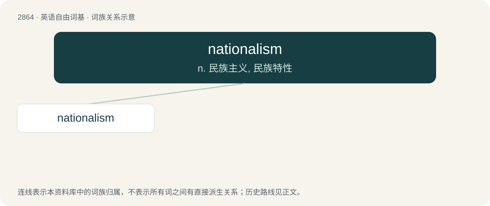

# 2974 · nationalism — n. 民族主义, 民族特性

[总目录](../00_总目录_按常用程度.md)

**类型**：英语自由词基　｜　**来源语言**：见词源记录

## 核心含义与来源

- 核心含义：n. 民族主义, 民族特性
- 英文含义：A more extreme form of patriotism; the idea of a more extreme support for one's country, people or culture.
- 词形：nationalism

**来源记录 1**（名词；A more extreme form of patriotism; the idea of a more extreme support for one's country, people or culture.）

Borrowed from French nationalisme, equivalent to national + -ism.

## 词族图

## 单词速览（常用到不常用）

| 单词 | 音标 | 释义 |
|---|---|---|
| [nationalism](#w-1) | 英 /ˈnæʃənəlɪz(ə)m/；美 /ˈnæʃ(ə)nəˌlɪzəm/ | n. 民族主义, 民族特性 |

## 逐词详解

### 1. nationalism

**词性**：名词　｜　**音标**：英 /ˈnæʃənəlɪz(ə)m/；美 /ˈnæʃ(ə)nəˌlɪzəm/

**中文释义**：n. 民族主义, 民族特性

**英文义项**：A more extreme form of patriotism; the idea of a more extreme support for one's country, people or culture. / Support for the creation of a sovereign nation (which does not currently exist).

**构词拆分**：national + -ism

**词源与演化**：

Borrowed from French nationalisme, equivalent to national + -ism.

**例句**：

> Communists, socialists, and Islamists are against nationalism.

该用例对应义项：A more extreme form of patriotism; the idea of a more extreme support for one's country, people or culture.
