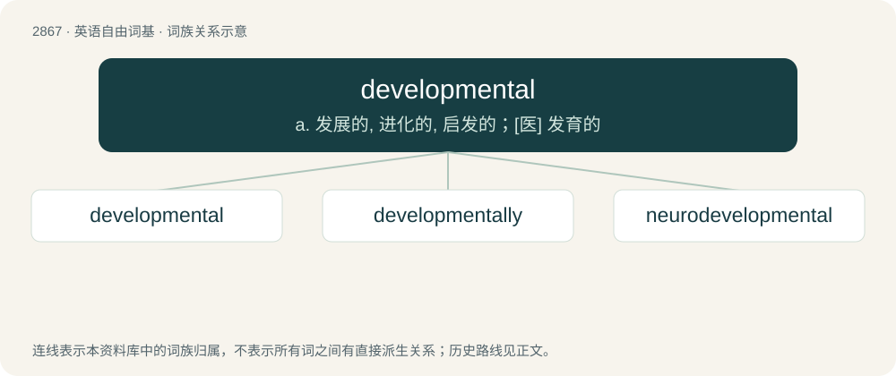

# 2976 · developmental — a. 发展的, 进化的, 启发的；\[医\] 发育的

[总目录](../00_总目录_按常用程度.md)

**类型**：英语自由词基　｜　**来源语言**：见词源记录

## 核心含义与来源

- 核心含义：a. 发展的, 进化的, 启发的；\[医\] 发育的
- 英文含义：Related to development.
- 词形：developmental

**来源记录 1**（形容词；Related to development.）

From development + -al.

## 词族图

## 单词速览（常用到不常用）

| 单词 | 音标 | 释义 |
|---|---|---|
| [developmental](#w-1) | /dɪˌvɛləpˈmɛntəl/ | a. 发展的, 进化的, 启发的；\[医\] 发育的 |
| [developmentally](#w-2) |  | \[医\]adv.发育地 |
| [neurodevelopmental](#w-3) | /nərəʊdiːˈveləpmentl/ | \[医\]神经发育的 |

## 逐词详解

### 1. developmental

**词性**：形容词　｜　**音标**：/dɪˌvɛləpˈmɛntəl/

**中文释义**：a. 发展的, 进化的, 启发的；\[医\] 发育的

**英文义项**：Related to development.

**构词拆分**：development + -al

**词源与演化**：

From development + -al.

**例句**：

> Developmental psychology studies how the mind forms as children and adolescents grow.

该用例对应义项：Related to development.

### 2. developmentally

**词性**：副词

**中文释义**：\[医\]adv.发育地

**英文义项**：In terms of development.

**构词拆分**：developmental + -ly

**词源与演化**：

From developmental + -ly.

### 3. neurodevelopmental

**词性**：形容词　｜　**音标**：/nərəʊdiːˈveləpmentl/

**中文释义**：\[医\]神经发育的

**英文义项**：Of or pertaining to the development of neurological pathways in the brain.

**构词拆分**：neuro- + developmental

**词源与演化**：

From neuro- + developmental.
