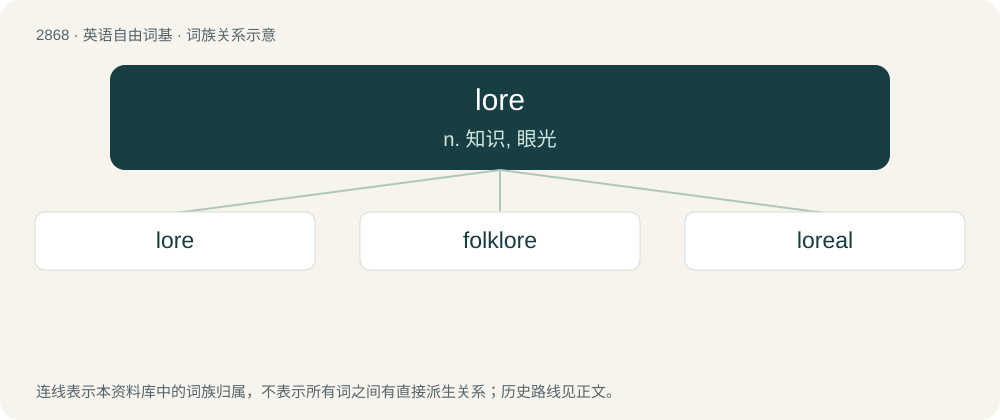

# 2977 · lore — n. 知识, 眼光

[总目录](../00_总目录_按常用程度.md)

**类型**：英语自由词基　｜　**来源语言**：见词源记录

## 核心含义与来源

- 核心含义：n. 知识, 眼光
- 英文含义：All the facts and traditions about a particular subject that have been accumulated over time through education or experience.
- 词形：lore

**多个词源／构词路径**：同一拼写可能有不同来源；以下按词性和含义分别列出。

**来源记录 1**（名词；All the facts and traditions about a particular subject that have been accumulated over time through education or experience.）

From Middle English lore, from Old English lār, from Proto-West Germanic \*laiʀu, from Proto-Germanic \*laizō, from \*laizijaną (“to teach”). Cognate with Dutch leer, German Lehre, Swedish lära and Danish lære. See also learn.

**来源记录 2**（名词；The region between the eyes and nostrils of birds, reptiles, and amphibians.）

From Latin lorum (“thong, strap”).

## 词族图

## 单词速览（常用到不常用）

| 单词 | 音标 | 释义 |
|---|---|---|
| [lore](#w-1) | 英 /lɔː/；美 /loɹ/ | n. 知识, 眼光 |
| [folklore](#w-2) | 英 /ˈfəʊk.lɔː/；美 /ˈfoʊk.lɔːɹ/ | n. 民俗学, 民间风俗, 民间传说 |
| [loreal](#w-3) | /lɔːreˈɪɑːl/ | \[医\]颊鳞 |

## 逐词详解

### 1. lore

**词性**：名词　｜　**音标**：英 /lɔː/；美 /loɹ/

**中文释义**：n. 知识, 眼光

**英文义项**：All the facts and traditions about a particular subject that have been accumulated over time through education or experience. / The backstory, especially for a character or setting, created around a fictional universe.

**词源与演化**：

From Middle English lore, from Old English lār, from Proto-West Germanic \*laiʀu, from Proto-Germanic \*laizō, from \*laizijaną (“to teach”). Cognate with Dutch leer, German Lehre, Swedish lära and Danish lære. See also learn.

**例句**：

> It's Ashot lore that I used to have a priv where I posted pictures of weird animals I found on the street.

该用例对应义项：Trivia shared by a person about themselves.

### 2. folklore

**词性**：名词　｜　**音标**：英 /ˈfəʊk.lɔː/；美 /ˈfoʊk.lɔːɹ/

**中文释义**：n. 民俗学, 民间风俗, 民间传说

**英文义项**：The tales, legends, superstitions, and traditions of a particular ethnic population. / The tales, superstitions etc. of any particular group or community.

**构词拆分**：folk + lore

**词源与演化**：

From folk + lore, coined by British writer William Thoms in 1846 to replace terms such as "popular antiquities". Thoms imitated German terms such as Volklehre (“people's customs”) and Volksüberlieferung (“popular tradition”). Compare also Old English folclar (“popular instruction; homily”) and West Frisian folkloare (“folklore”).

**例句**：

> Local folklore tells stories of legendary creatures living in the mountains.

### 3. loreal

**词性**：形容词　｜　**音标**：/lɔːreˈɪɑːl/

**中文释义**：\[医\]颊鳞

**英文义项**：Of or pertaining to the lore.

**构词拆分**：lore + -al

**词源与演化**：

From lore + -al.
