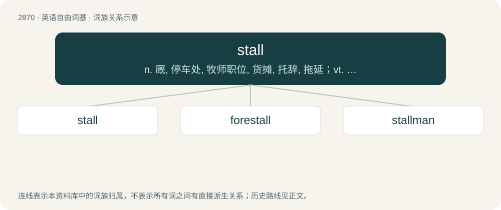

# 2978 · stall — n. 厩, 停车处, 牧师职位, 货摊, 托辞, 拖延；vt. 关入厩, 停顿, 推托, 支吾, 使陷于泥中；vi. 被关在厩内, 陷于泥中, 停止, 支吾

[总目录](../00_总目录_按常用程度.md)

**类型**：英语自由词基　｜　**来源语言**：见词源记录

## 核心含义与来源

- 核心含义：n. 厩, 停车处, 牧师职位, 货摊, 托辞, 拖延；vt. 关入厩, 停顿, 推托, 支吾, 使陷于泥中；vi. 被关在厩内, 陷于泥中, 停止, 支吾
- 英文含义：A compartment for a single animal in a stable or cattle shed.
- 词形：stall

**多个词源／构词路径**：同一拼写可能有不同来源；以下按词性和含义分别列出。

**来源记录 1**（名词；A compartment for a single animal in a stable or cattle shed.）

From Middle English stall, stalle, from Old English steall (“standing place, position”), from Proto-Germanic \*stallaz, from Proto-Indo-European \*stel- (“to place, put, post, stand”). Cognate with French étal, Italian stallo, German Stall, Swedish stall.

**来源记录 2**（名词；An action that is intended to cause, or actually causes, delay.）

From Middle English stallen (“to abide, dwell, place in a location, stop, come to a standstill”), partly from Old French estaler, ultimately from the same origin as Etymology 1 (see above); and partly from Middle English stalle (“fixed position, stall”).

## 词族图

## 单词速览（常用到不常用）

| 单词 | 音标 | 释义 |
|---|---|---|
| [stall](#w-1) | 英 /stɔːl/；/stoːl/ | n. 厩, 停车处, 牧师职位, 货摊, 托辞, 拖延；vt. 关入厩, 停顿, 推托, 支吾, 使陷于泥中；vi. 被关在厩内, 陷于泥中, 停止, 支吾 |
| [forestall](#w-2) | /fɔː(ɹ)ˈstɔːl/ | vt. 预先阻止, 先...一步行动, 占先一步, 垄断, 阻碍；\[法\] 先采取行动预防或阻止, 垄断 |
| [stallman](#w-3) | /ˈstɔːlmən/ | n. 摊贩 |

## 逐词详解

### 1. stall

**词性**：动词　｜　**音标**：英 /stɔːl/；/stoːl/

**中文释义**：n. 厩, 停车处, 牧师职位, 货摊, 托辞, 拖延；vt. 关入厩, 停顿, 推托, 支吾, 使陷于泥中；vi. 被关在厩内, 陷于泥中, 停止, 支吾

**英文义项**：To put (an animal, etc.) in a stall. / To fatten.

**词源与演化**：

From Middle English stall, stalle, from Old English steall (“standing place, position”), from Proto-Germanic \*stallaz, from Proto-Indo-European \*stel- (“to place, put, post, stand”). Cognate with French étal, Italian stallo, German Stall, Swedish stall.

**用法示例／搭配（非完整句）**：

> to stall cattle

该用例对应义项：To fatten.

### 2. forestall

**词性**：动词　｜　**音标**：/fɔː(ɹ)ˈstɔːl/

**中文释义**：vt. 预先阻止, 先...一步行动, 占先一步, 垄断, 阻碍；\[法\] 先采取行动预防或阻止, 垄断

**英文义项**：To prevent, delay or hinder something by taking precautionary or anticipatory measures; to avert. / To preclude or bar from happening, render impossible.

**构词拆分**：fore- + stall

**词源与演化**：

From Middle English forestallen (“to forestall, intercept, ambush, way-lay”), from forestalle (“a forestalling, interception”), from Old English foresteall (“intervention, hindrance of justice, ambush”), from fore- (“ahead of, before”) + steall (“position”), equivalent to fore- + stall.

**例句**：

> Fred forestalled disaster by his prompt action.

该用例对应义项：To prevent, delay or hinder something by taking precautionary or anticipatory measures; to avert.

### 3. stallman

**词性**：名词　｜　**音标**：/ˈstɔːlmən/

**中文释义**：n. 摊贩

**英文义项**：A male stallholder, especially one who sells books.

**构词拆分**：stall + -man

**词源与演化**：

From stall + -man.
