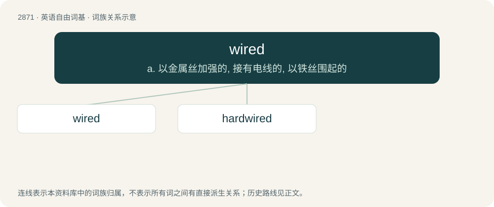

# 2979 · wired — a. 以金属丝加强的, 接有电线的, 以铁丝围起的

[总目录](../00_总目录_按常用程度.md)

**类型**：英语自由词基　｜　**来源语言**：见词源记录

## 核心含义与来源

- 核心含义：a. 以金属丝加强的, 接有电线的, 以铁丝围起的
- 英文含义：Equipped with wires, so as to connect to a power source or to other electric or electronic equipment; connected by wires.
- 词形：wired

**来源记录 1**（形容词；Equipped with wires, so as to connect to a power source or to other electric or electronic equipment; connected by wires.）

From wire + -ed.

## 词族图

## 单词速览（常用到不常用）

| 单词 | 音标 | 释义 |
|---|---|---|
| [wired](#w-1) | 英 /waɪəd/；美 /waɪɹd/ | a. 以金属丝加强的, 接有电线的, 以铁丝围起的 |
| [hardwired](#w-2) |  | a. 电路的 |

## 逐词详解

### 1. wired

**词性**：形容词　｜　**音标**：英 /waɪəd/；美 /waɪɹd/

**中文释义**：a. 以金属丝加强的, 接有电线的, 以铁丝围起的

**英文义项**：Equipped with wires, so as to connect to a power source or to other electric or electronic equipment; connected by wires. / Equipped with hidden electronic eavesdropping devices.

**构词拆分**：From wire + -ed.

**词源与演化**：

From wire + -ed.

**例句**：

> After three cups of coffee she was too wired to sleep.

该用例对应义项：Very excited, overstimulated; high-strung.

### 2. hardwired

**词性**：形容词

**中文释义**：a. 电路的

**英文义项**：Designed to perform a specific task. / Of devices, closely or tightly coupled.

**构词拆分**：hard + wired

**词源与演化**：

From hard + wired.

**例句**：

> I'm hardwired to have a shower every morning.

该用例对应义项：Having made a belief or a pattern of behavior or a habit.
