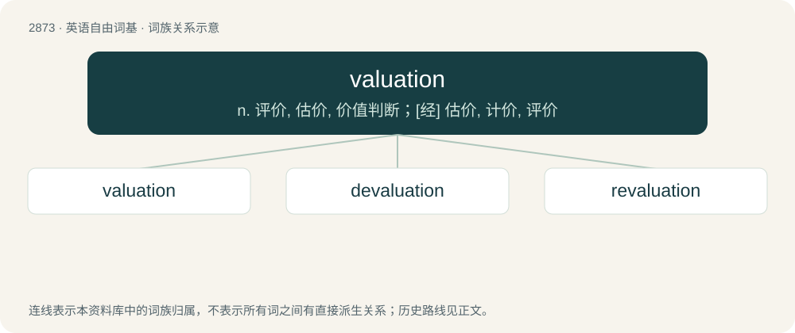

# 2981 · valuation — n. 评价, 估价, 价值判断；\[经\] 估价, 计价, 评价

[总目录](../00_总目录_按常用程度.md)

**类型**：英语自由词基　｜　**来源语言**：见词源记录

## 核心含义与来源

- 核心含义：n. 评价, 估价, 价值判断；\[经\] 估价, 计价, 评价
- 英文含义：An estimation of something's worth.
- 词形：valuation

**来源记录 1**（名词；An estimation of something's worth.）

From Middle French valuation, noun of action from valuer, from Old French valoir.

## 词族图

## 单词速览（常用到不常用）

| 单词 | 音标 | 释义 |
|---|---|---|
| [valuation](#w-1) | /ˌvæ.ljuːˈeɪ.ʃən/ | n. 评价, 估价, 价值判断；\[经\] 估价, 计价, 评价 |
| [devaluation](#w-2) | /,diːvæljuˈeiʃən/ | n. 降低价值, 贬值；\[经\] 贬值 |
| [revaluation](#w-3) | /.riːvæljuˈeiʃən/ | n. 再评价；\[经\] 再估价, 重新估价 |

## 逐词详解

### 1. valuation

**词性**：名词　｜　**音标**：/ˌvæ.ljuːˈeɪ.ʃən/

**中文释义**：n. 评价, 估价, 价值判断；\[经\] 估价, 计价, 评价

**英文义项**：An estimation of something's worth. / The process of estimating the value of a financial asset or liability.

**词源与演化**：

From Middle French valuation, noun of action from valuer, from Old French valoir.

**例句**：

> He set a high valuation on friendship.

该用例对应义项：an appraisal of the value of something

### 2. devaluation

**词性**：名词　｜　**音标**：/,diːvæljuˈeiʃən/

**中文释义**：n. 降低价值, 贬值；\[经\] 贬值

**英文义项**：The removal or lessening of something's value. / The intentional or deliberate lowering of a currency's value compared to another country's currency or a standard value (e.g. the price of gold).

**构词拆分**：de- + valuation

**词源与演化**：

From de- + valuation.

**例句**：

> The devaluation of femininity perpetuates harmful gender stereotypes and restricts individual expression.

### 3. revaluation

**词性**：名词　｜　**音标**：/.riːvæljuˈeiʃən/

**中文释义**：n. 再评价；\[经\] 再估价, 重新估价

**英文义项**：The process of altering the relative value of a currency or other standard of exchange. / A reassessment of the value or worth of something; a reappraisal or reevaluation.

**构词拆分**：re- + valuation

**词源与演化**：

From re- + valuation.

**例句**：

> After the soldiers raided her farm for supplies, she was forced to a revaluation of their benefit as protectors.

该用例对应义项：A reassessment of the value or worth of something; a reappraisal or reevaluation.
