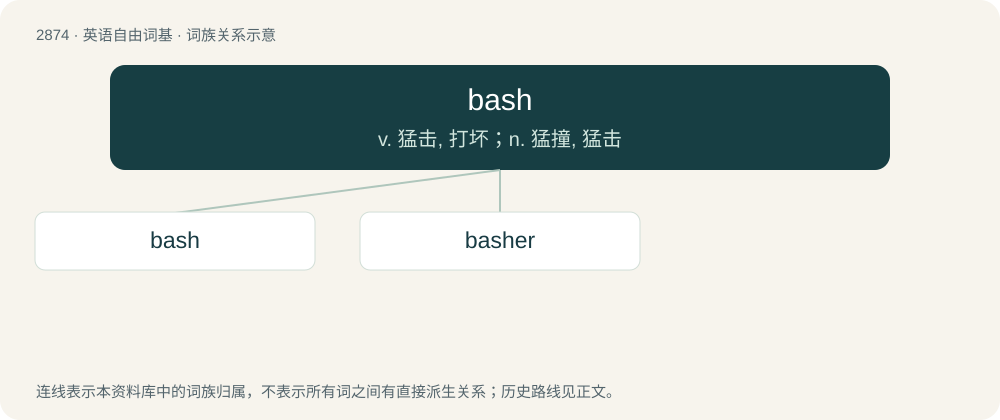

# 2982 · bash — v. 猛击, 打坏；n. 猛撞, 猛击

[总目录](../00_总目录_按常用程度.md)

**类型**：英语自由词基　｜　**来源语言**：见词源记录

## 核心含义与来源

- 核心含义：v. 猛击, 打坏；n. 猛撞, 猛击
- 英文含义：To strike heavily; to beat.
- 词形：bash

**来源记录 1**（动词；To strike heavily; to beat.）

From Middle English \*basshen, \*basken, likely from Old Norse \*baska (“to strike”), akin to Swedish basa (“to baste, whip, lash, flog”), Danish baske (“to beat, strike, cudgel”), German patschen (“to slap”)

## 词族图

## 单词速览（常用到不常用）

| 单词 | 音标 | 释义 |
|---|---|---|
| [bash](#w-1) | /bæʃ/ | v. 猛击, 打坏；n. 猛撞, 猛击 |
| [basher](#w-2) | 英 /ˈbæʃə/；美 /ˈbæʃɚ/ | 猛击者, \[澳\]抢劫罪犯, 散光灯, 小型照明灯 |

## 逐词详解

### 1. bash

**词性**：动词　｜　**音标**：/bæʃ/

**中文释义**：v. 猛击, 打坏；n. 猛撞, 猛击

**英文义项**：To strike heavily; to beat. / To collide; used with into or together.

**词源与演化**：

From Middle English \*basshen, \*basken, likely from Old Norse \*baska (“to strike”), akin to Swedish basa (“to baste, whip, lash, flog”), Danish baske (“to beat, strike, cudgel”), German patschen (“to slap”)

**例句**：

> If the engine won't start, bash it with this hammer.

该用例对应义项：To strike heavily; to beat.

### 2. basher

**词性**：名词　｜　**音标**：英 /ˈbæʃə/；美 /ˈbæʃɚ/

**中文释义**：猛击者, \[澳\]抢劫罪犯, 散光灯, 小型照明灯

**英文义项**：One who bashes something, figuratively or literally. / Before the days of pneumatic rivet guns, the member of a riveting team who hammered the rivet to upset the bucktail to form the field head (see rivet).

**构词拆分**：bash + -er

**词源与演化**：

From bash + -er.

**例句**：

> He was beaten up by a queer-basher.

该用例对应义项：One who engages in gratuitous physical or verbal attacks on a group or type of people.
