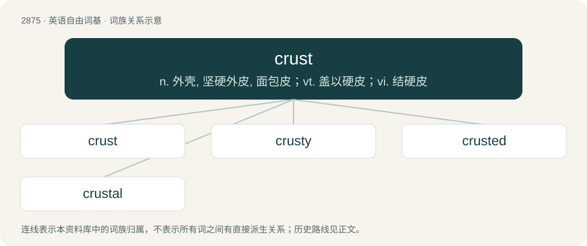

# 2983 · crust — n. 外壳, 坚硬外皮, 面包皮；vt. 盖以硬皮；vi. 结硬皮

[总目录](../00_总目录_按常用程度.md)

**类型**：英语自由词基　｜　**来源语言**：见词源记录

## 核心含义与来源

- 核心含义：n. 外壳, 坚硬外皮, 面包皮；vt. 盖以硬皮；vi. 结硬皮
- 英文含义：A more solid, dense or hard layer on a surface or boundary.
- 词形：crust

**来源记录 1**（名词；A more solid, dense or hard layer on a surface or boundary.）

From Middle English cruste, from Anglo-Norman and Old French cruste, from Latin crusta (“hard outer covering”), from Proto-Indo-European \*krustós (“hardened”), from \*krews- (“to form a crust, begin to freeze”), related to Old Norse hroðr (“scurf”), Old English hruse (“earth”), Old High German hrosa (“crust, ice”), Latvian kruvesis (“frozen mud”), Ancient Greek κρύος (krúos, “frost, icy cold”), κρύσταλλος (krústallos, “crystal, ice”), Avestan 𐬑𐬭𐬎𐬰𐬛𐬭𐬀- (xruzdra-, “hard”), Sanskrit क्रूड् (krūḍ, “thicken, make hard”). Doublet of crusta.

## 词族图

## 单词速览（常用到不常用）

| 单词 | 音标 | 释义 |
|---|---|---|
| [crust](#w-1) | /kɹʌst/ | n. 外壳, 坚硬外皮, 面包皮；vt. 盖以硬皮；vi. 结硬皮 |
| [crusty](#w-2) | /ˈkɹʌsti/ | a. 有硬皮的, 易怒的；\[建\] 硬的, 有壳的, 似外皮的 |
| [crusted](#w-3) | /ˈkɹʌstɪd/ | a. 有硬皮的, 有外壳的, 长了酒垢的, 陈旧的, 古色古香的 |
| [crustal](#w-4) | 英 /ˈkɹʌstəl/ | a. 地壳的；\[医\] 痂的; 壳的 |

## 逐词详解

### 1. crust

**词性**：名词　｜　**音标**：/kɹʌst/

**中文释义**：n. 外壳, 坚硬外皮, 面包皮；vt. 盖以硬皮；vi. 结硬皮

**英文义项**：A more solid, dense or hard layer on a surface or boundary. / The external, hardened layer of certain foodstuffs, including most types of bread, fried meat, etc.

**词源与演化**：

From Middle English cruste, from Anglo-Norman and Old French cruste, from Latin crusta (“hard outer covering”), from Proto-Indo-European \*krustós (“hardened”), from \*krews- (“to form a crust, begin to freeze”), related to Old Norse hroðr (“scurf”), Old English hruse (“earth”), Old High German hrosa (“crust, ice”), Latvian kruvesis (“frozen mud”), Ancient Greek κρύος (krúos, “frost, icy cold”), κρύσταλλος (krústallos, “crystal, ice”), Avestan 𐬑𐬭𐬎𐬰𐬛𐬭𐬀- (xruzdra-, “hard”), Sanskrit क्रूड् (krūḍ, “thicken, make hard”). Doublet of crusta.

**例句**：

> You've got a lot of crust standing there saying that.

该用例对应义项：Nerve, gall.

### 2. crusty

**词性**：形容词　｜　**音标**：/ˈkɹʌsti/

**中文释义**：a. 有硬皮的, 易怒的；\[建\] 硬的, 有壳的, 似外皮的

**英文义项**：Having a crust, especially a thick one. / Short-tempered and gruff but, sometimes, with a harmless or benign inner nature.

**构词拆分**：crust + -y

**词源与演化**：

From Middle English crusty, equivalent to crust + -y.

**例句**：

> The old vinyl record made a crusty crackling sound as the needle hit it.

该用例对应义项：Of very low quality; crude visuals or harsh, granular sound.

### 3. crusted

**词性**：形容词　｜　**音标**：/ˈkɹʌstɪd/

**中文释义**：a. 有硬皮的, 有外壳的, 长了酒垢的, 陈旧的, 古色古香的

**英文义项**：Having or consisting of a crust. / Characterized by crusty patches.

**构词拆分**：crust + -ed

**词源与演化**：

From crust + -ed.

### 4. crustal

**词性**：形容词　｜　**音标**：英 /ˈkɹʌstəl/

**中文释义**：a. 地壳的；\[医\] 痂的; 壳的

**英文义项**：Of, pertaining to, or forming a crust, especially the crust of the Earth or other planet.

**构词拆分**：crust + -al

**词源与演化**：

From crust + -al.
