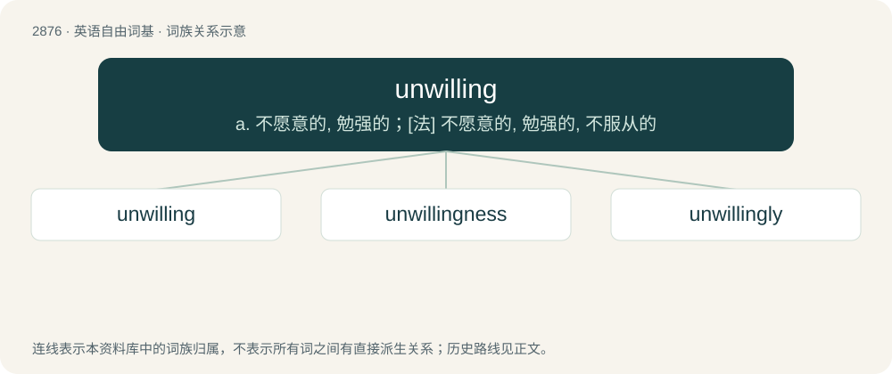

# 2984 · unwilling — a. 不愿意的, 勉强的；\[法\] 不愿意的, 勉强的, 不服从的

[总目录](../00_总目录_按常用程度.md)

**类型**：英语自由词基　｜　**来源语言**：见词源记录

## 核心含义与来源

- 核心含义：a. 不愿意的, 勉强的；\[法\] 不愿意的, 勉强的, 不服从的
- 英文含义：Not willing; reluctant
- 词形：unwilling

**来源记录 1**（形容词；Not willing; reluctant）

From un- + willing.

## 词族图

## 单词速览（常用到不常用）

| 单词 | 音标 | 释义 |
|---|---|---|
| [unwilling](#w-1) | /ʌnˈwɪlɪŋ/ | a. 不愿意的, 勉强的；\[法\] 不愿意的, 勉强的, 不服从的 |
| [unwillingness](#w-2) |  | n. 不情愿；不愿意 |
| [unwillingly](#w-3) | /ʌnˈwɪlɪŋlɪ/ | adv. 不情愿地, 勉强地; 勉勉强强 |

## 逐词详解

### 1. unwilling

**词性**：形容词　｜　**音标**：/ʌnˈwɪlɪŋ/

**中文释义**：a. 不愿意的, 勉强的；\[法\] 不愿意的, 勉强的, 不服从的

**英文义项**：Not willing; reluctant

**构词拆分**：un- + willing

**词源与演化**：

From un- + willing.

**例句**：

> We are unwilling to restore his previous privileges after his betrayal of our trust.

该用例对应义项：Not willing; reluctant

### 2. unwillingness

**词性**：名词

**中文释义**：n. 不情愿；不愿意

**英文义项**：The property of being unwilling.

**构词拆分**：unwilling + -ness

**词源与演化**：

From unwilling + -ness.

**例句**：

> His unwillingness to cooperate vetoed every proposal I made.

该用例对应义项：the trait of being unwilling

### 3. unwillingly

**词性**：副词　｜　**音标**：/ʌnˈwɪlɪŋlɪ/

**中文释义**：adv. 不情愿地, 勉强地; 勉勉强强

**英文义项**：In an unwilling or uncooperative manner.

**构词拆分**：unwilling + -ly；un- + willingly

**词源与演化**：

From unwilling + -ly or un- + willingly.

**例句**：

> He had sinned against her unwillingly.

该用例对应义项：in an unwilling manner
