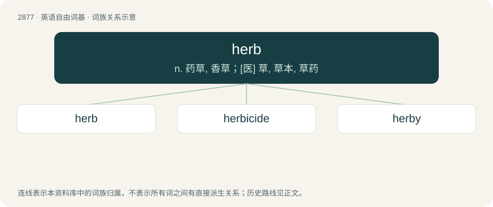

# 2985 · herb — n. 药草, 香草；\[医\] 草, 草本, 草药

[总目录](../00_总目录_按常用程度.md)

**类型**：英语自由词基　｜　**来源语言**：见词源记录

## 核心含义与来源

- 核心含义：n. 药草, 香草；\[医\] 草, 草本, 草药
- 英文含义：A plant whose stem is not woody and does not persist beyond each growing season.
- 词形：herb

**来源记录 1**（名词；A plant whose stem is not woody and does not persist beyond each growing season.）

From Middle English herbe, erbe, from Old French erbe (French herbe), from Latin herba. Initial h was restored to the spelling in the 15th century on the basis of Latin, but it remained mute until the 19th century and still is for many speakers. Doublet of yerba.

## 词族图

## 单词速览（常用到不常用）

| 单词 | 音标 | 释义 |
|---|---|---|
| [herb](#w-1) | 英 /hɜːb/；美 /(h)ɝb/ | n. 药草, 香草；\[医\] 草, 草本, 草药 |
| [herbicide](#w-2) | 英 /ˈhɜːbɪsaɪd/；美 /ˈ(h)ɝbɪsaɪd/ | n. 除草剂；\[化\] 除草剂 |
| [herby](#w-3) | 英 /ˈhɜː.bi/；美 /ˈ(h)ɝ.bi/ | a. 长满草的, 草的, 似草的 |

## 逐词详解

### 1. herb

**词性**：名词　｜　**音标**：英 /hɜːb/；美 /(h)ɝb/

**中文释义**：n. 药草, 香草；\[医\] 草, 草本, 草药

**英文义项**：A plant whose stem is not woody and does not persist beyond each growing season. / Any green, leafy plant, or parts thereof, used to flavour or season food.

**词源与演化**：

From Middle English herbe, erbe, from Old French erbe (French herbe), from Latin herba. Initial h was restored to the spelling in the 15th century on the basis of Latin, but it remained mute until the 19th century and still is for many speakers. Doublet of yerba.

**例句**：

> If any medicinal herbs used by witches were supposedly evil, then how come people from at least the past benefited from the healing properties of such herbs?

该用例对应义项：A plant whose roots, leaves or seeds, etc. are used in medicine.

### 2. herbicide

**词性**：名词　｜　**音标**：英 /ˈhɜːbɪsaɪd/；美 /ˈ(h)ɝbɪsaɪd/

**中文释义**：n. 除草剂；\[化\] 除草剂

**英文义项**：A substance used to kill plants.

**构词拆分**：From herb + -icide.

**词源与演化**：

From herb + -icide.

**例句**：

> Ziri accidentally sprayed some herbicide onto the trees and damaged them.

### 3. herby

**词性**：形容词　｜　**音标**：英 /ˈhɜː.bi/；美 /ˈ(h)ɝ.bi/

**中文释义**：a. 长满草的, 草的, 似草的

**英文义项**：Of or pertaining to herbs. / Full of herbal aroma or flavour.

**构词拆分**：herb + -y

**词源与演化**：

From herb + -y.

**例句**：

> There was the smell of seaweed in the air and of herby autumnal flowers.
