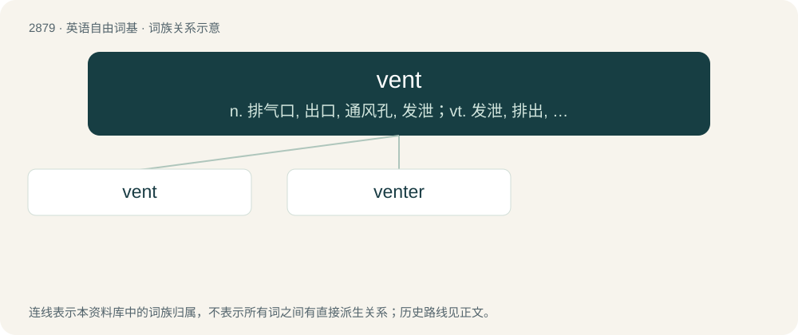

# 2987 · vent — n. 排气口, 出口, 通风孔, 发泄；vt. 发泄, 排出, 给...开孔

[总目录](../00_总目录_按常用程度.md)

**类型**：英语自由词基　｜　**来源语言**：见词源记录

## 核心含义与来源

- 核心含义：n. 排气口, 出口, 通风孔, 发泄；vt. 发泄, 排出, 给...开孔
- 英文含义：An opening through which gases, especially air, can pass.
- 词形：vent

**多个词源／构词路径**：同一拼写可能有不同来源；以下按词性和含义分别列出。

**来源记录 1**（名词；An opening through which gases, especially air, can pass.）

Partly from Middle French vent, from Latin ventus and partly from French éventer. Cognate with French vent and Spanish viento (“wind”) and ventana (“window”). Doublet of wind.

**来源记录 2**（名词；Ventriloquism.）

Clipping of ventriloquism.

**来源记录 3**（动词；To sell; to vend.）

From French vente, from Latin vendere (“to sell”).

**来源记录 4**（动词；To ventilate; to use a ventilator; to use ventilation.）

Clipping.

## 词族图

## 单词速览（常用到不常用）

| 单词 | 音标 | 释义 |
|---|---|---|
| [vent](#w-1) | /vɛnt/ | n. 排气口, 出口, 通风孔, 发泄；vt. 发泄, 排出, 给...开孔 |
| [venter](#w-2) | /ˈvɛn.tə(ɹ)/ | 【英文】One who vents, who is vocal about feelings or problems. |

## 逐词详解

### 1. vent

**词性**：名词　｜　**音标**：/vɛnt/

**中文释义**：n. 排气口, 出口, 通风孔, 发泄；vt. 发泄, 排出, 给...开孔

**英文义项**：An opening through which gases, especially air, can pass. / A small aperture.

**词源与演化**：

Partly from Middle French vent, from Latin ventus and partly from French éventer. Cognate with French vent and Spanish viento (“wind”) and ventana (“window”). Doublet of wind.

**用法示例／搭配（非完整句）**：

> the vent of a cask; the vent of a mould

该用例对应义项：An opening through which gases, especially air, can pass.

### 2. venter

**词性**：名词　｜　**音标**：/ˈvɛn.tə(ɹ)/

**英文义项**：One who vents, who is vocal about feelings or problems.

**构词拆分**：vent + -er

**词源与演化**：

From vent + -er.
