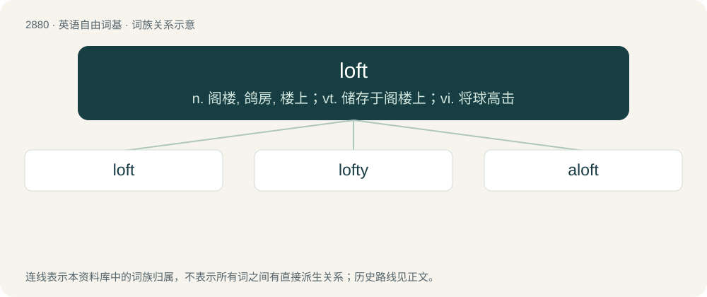

# 2989 · loft — n. 阁楼, 鸽房, 楼上；vt. 储存于阁楼上；vi. 将球高击

[总目录](../00_总目录_按常用程度.md)

**类型**：英语自由词基　｜　**来源语言**：见词源记录

## 核心含义与来源

- 核心含义：n. 阁楼, 鸽房, 楼上；vt. 储存于阁楼上；vi. 将球高击
- 英文含义：An attic or similar space (often used for storage) in the roof of a house or other building.
- 词形：loft

**来源记录 1**（名词；An attic or similar space (often used for storage) in the roof of a house or other building.）

From Middle English lofte (“air, sky, upper region, loft”), from Old English loft, (doublet of native Old English lyft) of North Germanic origin, from Old Norse lopt (“upper chamber, attic, region of sky, air”), from Proto-Germanic \*luftuz (“air, sky”). Akin to Scots lift (“air; sky; firmament”), Dutch lucht (“air”), German Luft (“air”), Old English lyft (“air”). Doublet of lift and luft. Related to aloft. Cognate with Scots loft, laft (“loft”), Irish lochta (“loft”).

## 词族图

## 单词速览（常用到不常用）

| 单词 | 音标 | 释义 |
|---|---|---|
| [loft](#w-1) | 英 /lɒft/；美 /lɔft/ | n. 阁楼, 鸽房, 楼上；vt. 储存于阁楼上；vi. 将球高击 |
| [lofty](#w-2) | 英 /ˈlɒfti/；美 /ˈlɔːfti/ | a. 高的, 傲慢的, 崇高的, 高级的, 玄虚的 |
| [aloft](#w-3) | 英 /əˈlɒft/；美 /əˈlɔft/ | adv. 在高处, 在上 |

## 逐词详解

### 1. loft

**词性**：名词　｜　**音标**：英 /lɒft/；美 /lɔft/

**中文释义**：n. 阁楼, 鸽房, 楼上；vt. 储存于阁楼上；vi. 将球高击

**英文义项**：An attic or similar space (often used for storage) in the roof of a house or other building. / Such an attic used as an atelier.

**词源与演化**：

From Middle English lofte (“air, sky, upper region, loft”), from Old English loft, (doublet of native Old English lyft) of North Germanic origin, from Old Norse lopt (“upper chamber, attic, region of sky, air”), from Proto-Germanic \*luftuz (“air, sky”). Akin to Scots lift (“air; sky; firmament”), Dutch lucht (“air”), German Luft (“air”), Old English lyft (“air”). Doublet of lift and luft. Related to aloft. Cognate with Scots loft, laft (“loft”), Irish lochta (“loft”).

**用法示例／搭配（非完整句）**：

> an artist's loft

该用例对应义项：Such an attic used as an atelier.

### 2. lofty

**词性**：形容词　｜　**音标**：英 /ˈlɒfti/；美 /ˈlɔːfti/

**中文释义**：a. 高的, 傲慢的, 崇高的, 高级的, 玄虚的

**英文义项**：High, tall, having great height or stature. / Idealistic, implying over-optimism.

**构词拆分**：loft (“sky, firmament; upper room”) + -y

**词源与演化**：

From Middle English lofty, lofti, lofte (“of high rank; noble; ornate”), equivalent to loft (“sky, firmament; upper room”) + -y.

**用法示例／搭配（非完整句）**：

> a lofty goal

该用例对应义项：Idealistic, implying over-optimism.

### 3. aloft

**词性**：副词　｜　**音标**：英 /əˈlɒft/；美 /əˈlɔft/

**中文释义**：adv. 在高处, 在上

**英文义项**：At, to, or in the air or sky. / Above, overhead, in a high place; up.

**构词拆分**：a- + loft

**词源与演化**：

From Old Norse á lopti (“in the sky”); equivalent to a- + loft.

**用法示例／搭配（非完整句）**：

> high winds aloft

该用例对应义项：At, to, or in the air or sky.
